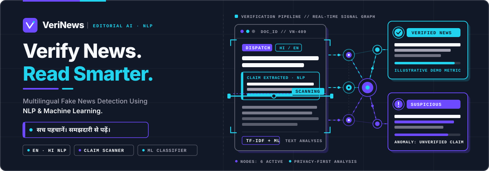
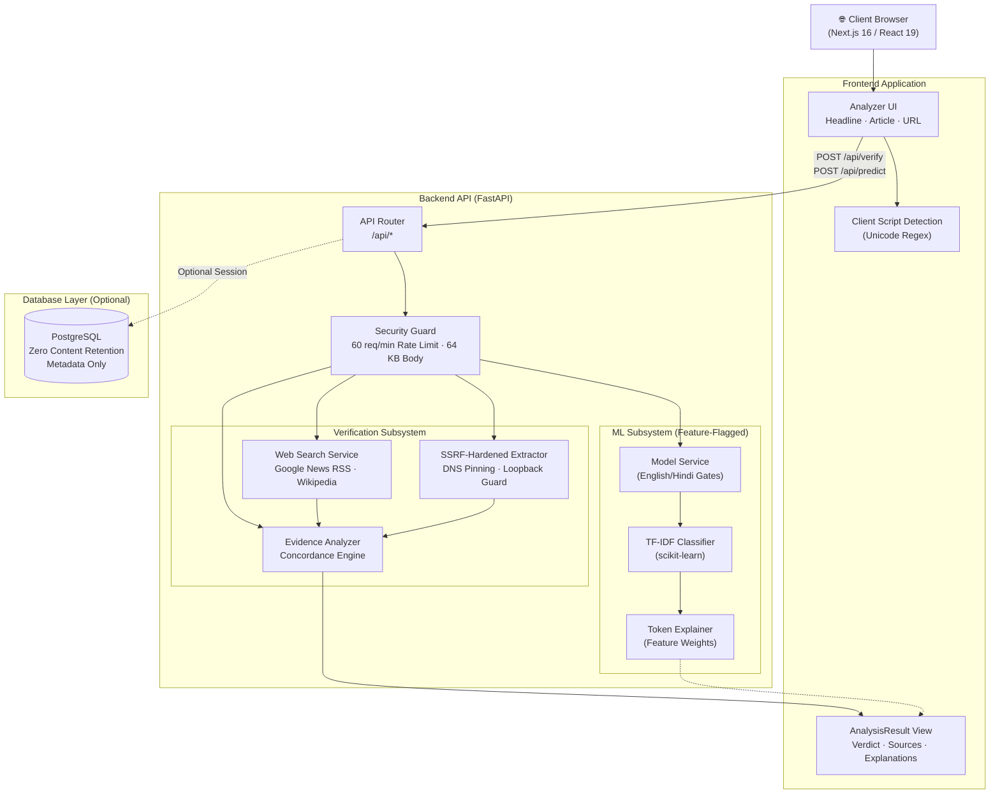
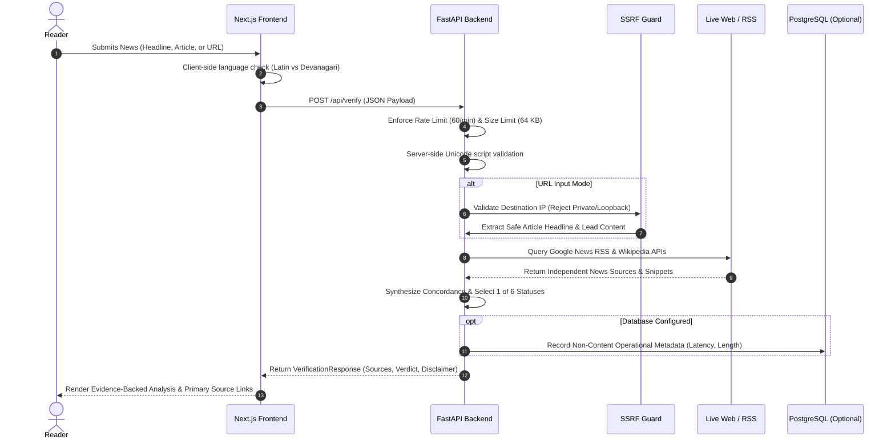
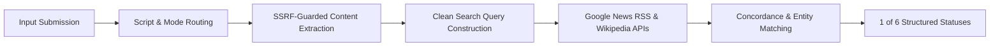

<p align="center">
  
</p>

<h1 align="center">VeriNews</h1>

<p align="center">
  <strong>Multilingual News Analysis &amp; Evidence-Assisted Verification</strong><br/>
  <em>समाचार सत्यापन · A research-grade full-stack application</em>
</p>

<p align="center">
  
  
  
  
  
  
</p>

---

## Table of Contents

1. [Project Overview](#1-project-overview)
2. [Key Features](#2-key-features)
3. [Live Demo and Prototype Status](#3-live-demo-and-prototype-status)
4. [Technology Stack](#4-technology-stack)
5. [Repository Structure](#5-repository-structure)
6. [System Architecture](#6-system-architecture)
7. [End-to-End Workflow](#7-end-to-end-workflow)
8. [API Reference and Contract](#8-api-reference-and-contract)
9. [Evidence-Assisted Verification Pipeline](#9-evidence-assisted-verification-pipeline)
10. [Machine Learning Pipeline](#10-machine-learning-pipeline)
11. [Frontend Design System](#11-frontend-design-system)
12. [Database Architecture and Zero Content Retention](#12-database-architecture-and-zero-content-retention)
13. [Security, SSRF Protection and Rate Limiting](#13-security-ssrf-protection-and-rate-limiting)
14. [Environment Configuration](#14-environment-configuration)
15. [Local Development Setup](#15-local-development-setup)
16. [Running Tests and Verification](#16-running-tests-and-verification)
17. [Project Tracker and Phase Gates](#17-project-tracker-and-phase-gates)
18. [Privacy and Data Handling](#18-privacy-and-data-handling)
19. [Responsible AI, Ethics and Limitations](#19-responsible-ai-ethics-and-limitations)
20. [Multilingual Support](#20-multilingual-support)
21. [Typography and Visual Identity](#21-typography-and-visual-identity)
22. [Knowledge Graph (Graphify)](#22-knowledge-graph-graphify)
23. [Scripts Reference](#23-scripts-reference)
24. [Contributing Guidelines](#24-contributing-guidelines)
25. [Project Roadmap](#25-project-roadmap)
26. [Canonical Phase Status Register](#26-canonical-phase-status-register)
27. [Acknowledgements and References](#27-acknowledgements-and-references)
28. [License](#28-license)
29. [Author and Contact](#29-author-and-contact)

---

## 1. Project Overview

**VeriNews** is an academic research prototype and full-stack web application developed to help users critically evaluate digital news headlines, article text, and web reports in both **English** and **Hindi (Devanagari)**.

Rather than acting as an opaque "truth machine" or claiming absolute factual certainty, VeriNews approaches credibility assessment through two complementary technical pillars:

1. **Evidence-Assisted Verification (`/api/verify`)** — Active and runtime-ready. Retrieves independent, real-time web evidence (Google News RSS, Wikipedia API, and secure URL scraping) and compares claims against reputable reporting, assigning one of six structured, epistemically honest statuses.
2. **Classical Machine Learning Analysis (`/api/predict`)** — Implemented in code (`ml/` and `model_service.py`). Features TF-IDF vectorization, scikit-learn classifiers, Platt sigmoid calibration, and per-token explainability.

> [!IMPORTANT]
> **Safety and Gating Invariant**: Model inference on `/api/predict` is **strictly feature-flagged OFF by default** (`VERINEWS_ENABLE_ENGLISH_INFERENCE=false`, `VERINEWS_ENABLE_HINDI_INFERENCE=false`). When disabled, the endpoint returns an honest `HTTP 503 Service Unavailable` error explaining that model inference is offline. Model serving requires formal dataset approval (Phase P01) and explicit mentor sign-off before activation.

Submitted news text is processed transiently in memory and is not persisted by the current verification routes.

---

## 2. Key Features

| Capability | Description | Runtime State |
|---|---|---|
| **Evidence-Assisted Verification** | Real-time web retrieval comparing claims against accredited reporting with source citations. | **Active & Functional** |
| **Epistemically Honest Verdicts** | Evaluates claims into six responsible categories rather than naive binary labels. | **Active & Functional** |
| **Secure URL Extraction** | Server-side news fetching with defense-in-depth SSRF protection, DNS pinning, and private IP blocking. | **Active & Functional** |
| **Bilingual Language Routing** | Automatic client and server detection of Latin script (English) and Devanagari script (Hindi). | **Active & Functional** |
| **Classical ML Pipeline** | TF-IDF feature extraction, balanced classifiers, Platt calibration, and token explainability. | **Implemented (Feature-Flagged Off)** |
| **Zero Content Retention** | Raw submitted news content is never stored; database models record non-content operational and statistical metadata only. | **Modeled & Unit-Tested (Decoupled at Runtime)** |
| **Security & Rate Limiting** | Sliding-window limiter (60 req/min per IP) and 64 KB payload size protection. | **Active & Functional** |
| **Cinematic Interface** | Dark-mode-first design with GSAP animations, Lenis smooth scrolling, and neural vortex background. | **Active & Functional** |
| **OpenAPI / Swagger Contract** | Interactive schema documentation available at `/api/docs` and `/api/redoc`. | **Active & Functional** |

---

## 3. Live Demo and Prototype Status

> [!NOTE]
> VeriNews is an active **academic research prototype**. There is currently **no public production deployment or hosted SaaS URL**. All functionality is evaluated through local execution following the [Local Development Setup](#15-local-development-setup).

---

## 4. Technology Stack

### Frontend

| Technology | Version | Purpose |
|---|---|---|
| Next.js | 16.4.5 | App Router architecture, SSR, font optimization |
| React | 19.3.1 | Core UI component model |
| TypeScript | 5.7.3 | Static type checking and schema safety |
| Tailwind CSS | 3.4.17 | Utility styling and responsive tokens |
| GSAP | ^3.15.1 | High-performance timeline animations |
| Lenis | ^1.3.27 | Kinetic smooth scrolling engine |

*Note: Three.js was replaced by a lightweight HTML5 Canvas neural vortex background to reduce bundle size and memory overhead.*

### Backend & Data

| Technology | Version | Purpose |
|---|---|---|
| Python | 3.11+ | Runtime environment |
| FastAPI | 0.162.2 | High-concurrency async REST API |
| Pydantic | 2.14.3 | Strict request/response payload validation |
| SQLAlchemy | 2.1.8 | Database ORM and relational modeling |
| Alembic | 1.20.1 | Database schema migrations |
| psycopg (psycopg3) | 3.3.8 | Binary PostgreSQL adapter with async support |
| Uvicorn | 0.54.0 | High-performance ASGI server |
| HTTPX | 0.28.1 | Async HTTP client for external evidence retrieval |
| python-dotenv | 1.2.4 | Environment variable management |

### Machine Learning & Verification

| Technology | Version | Purpose |
|---|---|---|
| scikit-learn | 1.9.1 | Classical classifiers, TF-IDF vectorizer, calibration |
| NumPy | 2.5.4 | Numerical computing and matrix operations |
| Pandas | 3.1.1 | Data manipulation and dataset ingestion routines |
| SciPy | 1.18.1 | Statistical calibration utilities |
| joblib | 1.6.0 | Model artifact serialization |

### Tooling & Governance

| Tool | Purpose |
|---|---|
| Pytest (9.2.0) | Automated backend and ML unit test suites |
| ESLint (9.39.5) | Frontend code quality and static analysis |
| Graphify | Developer knowledge graph for architectural visualization |

---

## 5. Repository Structure

```
VeriNews/
├── assets/                         # Static visual assets (banner, logos)
│   └── verinews-readme-banner.svg
├── backend/
│   ├── alembic/                    # Database migration environment
│   │   ├── versions/               # Versioned Alembic migration scripts
│   │   └── env.py
│   ├── app/
│   │   ├── api/
│   │   │   └── routes.py           # REST endpoints (/health, /verify, /predict, /samples)
│   │   ├── core/
│   │   │   └── config.py           # Settings, paths, environment flags
│   │   ├── db/
│   │   │   ├── base.py             # Declarative Base
│   │   │   ├── models.py           # User, Analysis, UserFeedback models
│   │   │   └── session.py          # Session factory and optional DB dependency
│   │   ├── schemas/                # Pydantic validation contracts
│   │   │   ├── health.py
│   │   │   ├── prediction.py
│   │   │   ├── samples.py
│   │   │   └── verification.py
│   │   ├── services/
│   │   │   ├── evidence_analyzer.py# Evidence synthesis & concordance engine
│   │   │   ├── language.py         # Unicode script detection (en/hi)
│   │   │   ├── model_service.py    # Gated ML model loading and inference
│   │   │   ├── url_extractor.py    # SSRF-hardened news article scraper
│   │   │   └── web_search.py       # Live web evidence retrieval service
│   │   └── main.py                 # FastAPI application, rate limiting, CORS
│   ├── tests/                      # Pytest backend test suite
│   └── requirements.txt            # Backend Python dependencies
├── frontend/
│   ├── public/
│   │   └── fonts/                  # Local typography assets (Brunson, Heading Now)
│   ├── src/
│   │   ├── app/
│   │   │   ├── layout.tsx          # Root layout, fonts, theme provider
│   │   │   └── page.tsx            # Main page routing
│   │   ├── components/
│   │   │   ├── Analyzer.tsx        # Main input submission component
│   │   │   ├── AnalysisResult.tsx  # Evidence and verdict presentation card
│   │   │   ├── NavBar.tsx          # Responsive navigation header
│   │   │   ├── Footer.tsx          # Project footer
│   │   │   └── ui/                 # Reusable design tokens and UI components
│   │   ├── App.tsx                 # Core UI state machine and API client
│   │   └── types.ts                # TypeScript interface definitions
│   ├── package.json
│   └── tsconfig.json
├── ml/                             # Machine learning library
│   ├── calibration.py              # Platt sigmoid probability calibration
│   ├── explainability.py           # TF-IDF token attribution engine
│   ├── labels.py                   # Canonical binary label definitions
│   ├── pipeline.py                 # Classical training and evaluation pipeline
│   ├── quality.py                  # Dataset quality and duplicate detection
│   ├── readers.py                  # Format-agnostic dataset readers
│   ├── schemas.py                  # ML dataclasses and record validation
│   ├── validation.py               # Cross-validation and split auditing
│   └── tests/                      # ML pipeline unit test suite
├── docs/                           # Canonical project documentation
│   ├── PHASE_STATUS.md             # Authoritative phase register
│   └── ROADMAP.md                  # Comprehensive architectural roadmap
├── project-tracker/                # Formal progress tracking registers
│   ├── README.md                   # Tracker workflow rules
│   ├── progress.json               # Task-by-task execution status
│   ├── roadmap.json                # Structured phase milestone data
│   └── activity-log.json           # Append-only development log
├── scripts/                        # Repository maintenance scripts
│   ├── start-backend-local.ps1     # Local backend runner
│   ├── update_project_tracker.mjs  # Tracker update utility
│   └── validate_project_tracker.mjs# Tracker consistency validator
├── graphify-out/                   # Generated developer knowledge graph
├── .env.example                    # Environment variable configuration template
├── alembic.ini                     # Migration runner configuration
├── pytest.ini                      # Pytest configuration
├── requirements.txt                # ML and root Python dependencies
├── AGENTS.md                       # Development agent operating instructions
└── LICENSE                         # MIT License
```

---

## 6. System Architecture



---

## 7. End-to-End Workflow



---

## 8. API Reference and Contract

The VeriNews REST API is served by default at `http://localhost:8000/api`. Interactive documentation is hosted at `/api/docs` (Swagger UI) and `/api/redoc` (ReDoc).

### Endpoints Overview

| Method | Endpoint | Description |
|---|---|---|
| `GET` | `/` | Service root probe confirming API availability. |
| `GET` | `/api/health` | Health probe returning service state and model loading flags. |
| `GET` | `/api/samples` | Pre-curated, illustrative sample news excerpts. |
| `POST` | `/api/verify` | AI-assisted news verification using real-time web evidence. |
| `POST` | `/api/predict` | Stylistic headline ML analysis (*feature-flagged OFF by default*). |

---

### `GET /api/health`

Returns application service health and indicates whether language model artifacts are currently loaded for inference.

**Response (`200 OK`):**
```json
{
  "status": "healthy",
  "version": "0.1.0",
  "models_loaded": {
    "english": false,
    "hindi": false
  }
}
```

---

### `POST /api/verify`

The primary active verification endpoint. Compares submitted claims or web URLs against independent live reporting and returns a structured verdict from six responsible AI categories.

**Request Body (`VerificationRequest`):**
```json
{
  "input_type": "headline",
  "text": "City Council Approves New Public Library Construction",
  "url": null,
  "language_hint": "auto"
}
```

| Field | Type | Description |
|---|---|---|
| `input_type` | `string` | Submission format: `"headline"`, `"article"`, or `"url"`. |
| `text` | `string \| null` | Headline (10–500 chars) or article text (20–10,000 chars). |
| `url` | `string \| null` | Target news URL when `input_type` is `"url"`. |
| `language_hint` | `string` | Optional language preference: `"auto"`, `"en"`, or `"hi"`. |

**Illustrative Response Schema (`200 OK` — `VerificationResponse`):**

> *Note: This response example is an illustrative demonstration of the payload schema. The domain `news.example.com` and its associated snippets are synthetic placeholders, not an actual verification query result.*

```json
{
  "status": "Supported by Available Evidence",
  "summary": "City Council Approves New Public Library Construction",
  "claim_checked": "City Council Approves New Public Library Construction",
  "explanation": "Independent news reports confirm municipal approval for the new library facility.",
  "supporting_evidence": [
    "Local reporting outlets document official approval by the council."
  ],
  "contradictory_evidence": [],
  "missing_context": [],
  "sources": [
    {
      "title": "Council greenlights new public library construction",
      "publisher": "news.example.com",
      "url": "https://news.example.com/library-approval",
      "snippet": "City council members voted unanimously to fund construction...",
      "date": "2026-11-10"
    }
  ],
  "detected_language": "en",
  "language_name": "English",
  "input_type": "headline",
  "extracted_headline": null,
  "limitations": [],
  "disclaimer": "VeriNews provides AI-assisted evidence analysis based on live web retrieval. Web coverage indicates presence in public discourse, not judicial factual certainty. Always verify critical claims with accredited fact-checking organizations.",
  "model_version": "VeriNews-Evidence-MVP-v1",
  "latency_ms": 782.4,
  "prediction_label": "Supported by Available Evidence",
  "is_credible": true,
  "confidence_score": null,
  "confidence_tier": "Evidence-Assisted Assessment (No Numerical Probability Fabricated)"
}
```

*Note: For evidence-assisted verification, `confidence_score` is intentionally `null`. VeriNews does not fabricate artificial numerical probabilities for real-world factual claims.*

---

### `POST /api/predict`

Classical machine learning analysis evaluating stylistic and linguistic patterns in news headlines.

> [!WARNING]
> By default, this endpoint returns `HTTP 503 Service Unavailable`. Inference is feature-flagged off until a certified, mentor-approved model artifact is loaded.

**Request Body (`PredictionRequest`):**
```json
{
  "text": "Cabinet approves new incentive scheme for domestic solar manufacturing today.",
  "language_hint": "auto"
}
```

| Field | Type | Constraint | Description |
|---|---|---|---|
| `text` | `string` | 20–500 chars | News headline or claim statement. |
| `language_hint` | `string` | `"auto"`, `"en"`, `"hi"` | Language selection hint. |

**Response (`200 OK` — when model inference is activated):**
```json
{
  "detected_language": "en",
  "language_name": "English",
  "prediction_label": "credible",
  "is_credible": true,
  "confidence_score": 0.842,
  "confidence_tier": "High Confidence",
  "influential_tokens": [
    { "token": "approves", "weight": 1.42, "direction": "credible" },
    { "token": "incentive", "weight": 0.98, "direction": "credible" }
  ],
  "disclaimer": "VeriNews analyzes stylistic and linguistic markers. This assessment does not verify empirical facts. Always verify important news with accredited fact-checkers.",
  "model_version": "en_ifnd_indian_headlines_calibrated_sigmoid.joblib",
  "latency_ms": 16.5
}
```

**Default Disabled Response (`503 Service Unavailable`):**
```json
{
  "detail": "Model service is currently unavailable. No approved trained model artifact is active.",
  "error_code": "HTTP_503"
}
```

---

## 9. Evidence-Assisted Verification Pipeline

The verification engine (`backend/app/services/evidence_analyzer.py`) processes submissions through an epistemically grounded workflow:



### The Six Responsible AI Verdicts

1. **`Supported by Available Evidence`** — The core assertion is corroborated by multiple reputable independent reporting outlets.
2. **`Contradicted by Available Evidence`** — Major reporting or accredited fact-checking agencies have refuted or debunked the assertion.
3. **`Partially Supported`** — Core elements are corroborated, but key numerical values, names, or secondary assertions remain unverified or disputed.
4. **`Misleading or Missing Context`** — The stated facts may be technically accurate, but key context, timelines, or qualifications were omitted to alter reader perception.
5. **`Insufficient Evidence`** — Reliable, independent news coverage is currently too sparse to make an objective determination.
6. **`Unable to Verify`** — External queries failed, destination servers were unreachable, or submitted claims could not be processed reliably.

---

## 10. Machine Learning Pipeline

The classical ML architecture (`ml/pipeline.py`) provides an explainable, CPU-efficient NLP baseline:

- **Vectorization**: scikit-learn `TfidfVectorizer` configured with unigrams and bigrams (`ngram_range=(1, 2)`), sublinear term frequency scaling (`sublinear_tf=True`), and a Unicode regex pattern preserving both Latin and Devanagari word tokens (`token_pattern=r"(?u)\b\w+\b"`).
- **Classification**: `LogisticRegression(class_weight="balanced", max_iter=1000, solver="lbfgs")`.
- **Calibration**: Platt sigmoid scaling via `CalibratedClassifierCV(method="sigmoid", cv="prefit")` in `ml/calibration.py` to ensure output probabilities reflect true empirical error rates.
- **Explainability**: `TFIDFExplainer` in `ml/explainability.py` extracts top positive and negative feature coefficients for transparent token attribution without black-box surrogate models.

> [!NOTE]
> **Dataset Status (Phase P01)**: Dataset feasibility, licensing terms, and data provenance audits are active under Phase P01. While baseline candidate artifacts exist in `models/` for local experimentation, **no production model has received mentor clearance**. The runtime pipeline remains gated accordingly.

---

## 11. Frontend Design System

The VeriNews user interface is a responsive, dark-mode-first web application designed with high aesthetic polish:

- **Visual Theme**: Deep navy background (`#040d1a`), subtle cyan highlights (`#06efdf`), electric blue focus accents (`#00b4d8`), and muted violet borders (`#7b5ea7`).
- **Interactive Background**: Custom canvas-based neural vortex background with dynamic particle physics that gracefully scales down CPU usage on battery or lower-tier hardware.
- **Micro-Interactions**: Custom trailing precision cursor (`electric-arc-cursor.tsx`), magnetic hover attraction buttons (`MagneticButton.tsx`), and responsive glassmorphic cards (`GlassCard.tsx`).
- **Accessibility Compliance**: Full support for `prefers-reduced-motion` (disabling smooth scrolling, heavy particle movement, and cursor trails) and WCAG AA contrast standards.

### Frontend Architecture: App Router (`src/app/`) and Client Core (`App.tsx`)

The frontend application cleanly separates the Next.js 16 server-rendered document shell from client-side state orchestration:

- **`src/app/layout.tsx`**: Next.js App Router root layout. Injects Google Fonts (`Manrope`, `Inter`, `Noto_Sans_Devanagari`) as CSS variables, sets page metadata, runs the flash-free theme initialization script (`themeInitScript`), and wraps children with the `SmoothScrollProvider` (synchronizing Lenis with the GSAP ticker) and `ElectricArcCursor`.
- **`src/app/page.tsx`**: The root route (`/`) server/client entrypoint that renders `<App />`.
- **`src/App.tsx`**: The main interactive client state container (`'use client'`). Manages UI state (`isAnalyzing`, `analysisResult`, `notice`, `activeModal`), determines backend API resolution via `resolveApiBase()` (`NEXT_PUBLIC_API_URL` or localhost fallback), orchestrates submissions to `POST /api/verify` (with fallback to `POST /api/predict`), transforms JSON payloads into display viewmodels, and composes page sections (`NavBar`, `HeroSection`, `Analyzer`, `AnalysisResult`, `WhyVeriNewsSection`, `TransparencySection`, `Footer`, `InfoModal`).

---

## 12. Database Architecture and Zero Content Retention

### Zero Content Retention Design

Within the ORM schema (`backend/app/db/models.py`) and current verification routes (`backend/app/api/routes.py`), Zero Content Retention applies to user-submitted news content:
- Article text, excerpts, and headlines are omitted from database tables (`Analysis` records only `input_char_length`).
- Deterministic content hashes (`input_hash`) and raw token/feature fields (`influential_tokens`, `influential_features`) are excluded from the `Analysis` schema.
- `UserFeedback` records structured agreement booleans and category codes without a free-text `comment` column.

*Data Retention Clarification*: Within the database schema and current verification routes, Zero Content Retention means submitted news content is not stored. However, if an optional database is configured and connected, non-content operational metadata and registered user account credentials may be persisted. It does not imply that no data of any kind is retained.

### Entity Models (`backend/app/db/models.py`)

1. **`User`** (`users` table): Stores account credentials and authentication metadata (`id`, `email`, `password_hash`, `is_active`, `is_verified`, `created_at`, `updated_at`).
2. **`Analysis`** (`analyses` table): Stores non-content operational and statistical metadata (`id`, `user_id`, `input_char_length`, `detected_language`, `language_routing_method`, `prediction_label`, `is_credible`, `confidence_score`, `confidence_tier`, `model_version`, `latency_ms`, `created_at`).
3. **`UserFeedback`** (`user_feedback` table): Stores structured agreement indicators and feedback categories (`id`, `analysis_id`, `user_id`, `agreed_with_prediction`, `feedback_category`, `created_at`).

### Optional Database Decoupling

The database connection is **optional** during local evaluation. When `DATABASE_URL` is omitted, `get_optional_db` (`backend/app/db/session.py`) yields `None`. While the ORM models and initial Alembic migration (`backend/alembic/versions/74b8faa3f360_initial_schema_for_users_analyses_and_.py`) are implemented—with schema column invariants checked in `backend/tests/test_database.py` and live PostgreSQL tests requiring `DATABASE_URL`—neither `/api/verify` nor `/api/predict` writes analysis records to PostgreSQL at runtime, operating statelessly in memory instead.

---

## 13. Security, SSRF Protection and Rate Limiting

### SSRF Protection (`backend/app/services/url_extractor.py`)

When verifying news via URL input, VeriNews enforces strict defense-in-depth measures against Server-Side Request Forgery (SSRF) and DNS rebinding:
- **Public IP Validation**: Inspects resolved IP addresses and rejects all private, loopback, link-local, multicast, reserved, NAT64-translated, and 6to4-embedded addresses.
- **Connection-Level DNS Pinning**: Connects directly to the pre-validated IP address using custom HTTP transport to eliminate Time-of-Check to Time-of-Use (TOCTOU) DNS rebinding attacks.
- **Bounded Redirects**: Follows a maximum of 3 manual redirects, re-verifying host and IP safety on every hop.
- **Resource Limits**: Enforces an 8.0-second network timeout and a 2 MB maximum response size limit.

### Rate Limiting & Request Protection (`backend/app/main.py`)

- **Sliding-Window Rate Limiting**: In-process sliding-window tracker enforcing a limit of **60 requests per minute** per client IP on `/api/verify` and `/api/predict`.
- **Payload Guard**: Rejects incoming request bodies exceeding **64 KB** with `HTTP 413 Content Too Large`.
- **CORS Protection**: Origin-checked middleware configurable via `VERINEWS_CORS_ORIGINS`.

---

## 14. Environment Configuration

Configuration is managed via repository-root `.env`. A complete template is provided in [.env.example](.env.example):

```powershell
Copy-Item .env.example .env
```

### Key Environment Variables

| Variable | Default | Purpose |
|---|---|---|
| `VERINEWS_ENV` | `development` | Runtime environment (`development`, `test`, `production`). |
| `DATABASE_URL` | *None (optional)* | PostgreSQL connection string (`postgresql+psycopg://...`). |
| `VERINEWS_CORS_ORIGINS` | `http://localhost:3000,...` | Comma-separated list of permitted CORS web origins. |
| `NEXT_PUBLIC_API_URL` | `http://localhost:8000` | Frontend target URL for backend API calls. |
| `VERINEWS_ENABLE_ENGLISH_INFERENCE` | `false` | Feature flag to enable English model inference. |
| `VERINEWS_ENABLE_HINDI_INFERENCE` | `false` | Feature flag to enable Hindi model inference. |
| `VERINEWS_DEFAULT_ENGLISH_ARTIFACT` | `en_ifnd_...calibrated_sigmoid.joblib` | Target English model artifact name. |
| `VERINEWS_DEFAULT_HINDI_ARTIFACT` | `hi_tallip_...calibrated_sigmoid.joblib` | Target Hindi model artifact name. |
| `VERINEWS_MODELS_DIR` | `models/` | Path to serialized candidate model storage. |
| `GEMINI_API_KEY` | *Optional* | External LLM key for generative synthesis fallback. |
| `OPENAI_API_KEY` | *Optional* | Alternative external LLM key for synthesis. |
| `TAVILY_API_KEY` | *Optional* | Optional premium search provider key. |
| `SERPAPI_API_KEY` | *Optional* | Optional alternative search provider key. |

---

## 15. Local Development Setup

These instructions have been tested on Windows PowerShell and modern POSIX terminals.

### Prerequisites

- **Python** 3.11 or higher
- **Node.js** 20+ and **npm** 10+
- **Git**
- *(Optional)* PostgreSQL 15+ if testing database persistence

### Step 1 — Clone the Repository

```powershell
git clone https://github.com/mddanish-31/VeriNews.git
cd VeriNews
```

### Step 2 — Create and Activate Python Virtual Environment

```powershell
python -m venv .venv
.\.venv\Scripts\Activate.ps1
```

### Step 3 — Install Python Dependencies

```powershell
# Install ML and root dependencies
pip install -r requirements.txt

# Install FastAPI backend dependencies
pip install -r backend/requirements.txt
```

### Step 4 — Configure Environment Variables

```powershell
Copy-Item .env.example .env
# Edit .env to customize settings if desired
```

### Step 5 — (Optional) Apply Database Migrations

*If running statelessly without PostgreSQL, skip this step. If `DATABASE_URL` is set in `.env`:*

```powershell
alembic upgrade head
```

### Step 6 — Start the Backend API Server

```powershell
# From the repository root with .venv active:
uvicorn backend.app.main:app --reload

# Alternatively, use the helper script:
.\scripts\start-backend-local.ps1
```

The backend API will be available at `http://localhost:8000`. Verify by opening `http://localhost:8000/api/health` in your browser.

### Step 7 — Start the Frontend Application

Open a second terminal:

```powershell
cd frontend
npm install
npm run dev
```

The user interface will be available at `http://localhost:3000`.

---

## 16. Running Tests and Verification

VeriNews maintains automated test suites covering backend API endpoints, security invariants, and ML pipelines.

### Backend Test Suite

```powershell
# With .venv active from repo root:
pytest backend/tests/
```

### Machine Learning Unit Tests

```powershell
pytest ml/tests/
```

### Frontend Typecheck, Linting and Build

```powershell
cd frontend
npm run typecheck
npm run lint
npm run build
```

### Project Tracker Consistency Validation

```powershell
# From repository root:
node scripts/validate_project_tracker.mjs
```

---

## 17. Project Tracker and Phase Gates

VeriNews uses a disciplined, phase-gated engineering methodology. All development tasks are tracked through machine-readable registers under `project-tracker/`:

- [project-tracker/README.md](project-tracker/README.md) — Workflow instructions and transition protocols.
- [project-tracker/progress.json](project-tracker/progress.json) — Current status of every task across all phases.
- [project-tracker/roadmap.json](project-tracker/roadmap.json) — Structured phase milestones and dependencies.
- [project-tracker/activity-log.json](project-tracker/activity-log.json) — Append-only chronological activity log.

> [!CAUTION]
> Hard Phase Gates: Dataset clearance (P01), model training sign-off (P10), and production release require explicit mentor/owner review. No development agent or automated process is authorized to bypass these gates.

---

## 18. Privacy and Data Handling

- **In-Memory Processing**: User-submitted texts, article snippets, and URLs are processed ephemerally in RAM during request execution and are never written to disk or permanent logs.
- **Privacy-Preserving Logs**: Application log output records only character lengths, detected scripts, and latency metrics. Raw text inputs are sanitized from all logs.
- **Search Query Privacy**: Live web search queries strip quotation marks, special characters, and extraneous terms, querying news feeds with objective topical phrases.
- **Transient Rate Limit State**: Client IP addresses tracked by the sliding-window rate limiter are maintained in-memory only and evicted automatically every 60 seconds.

---

## 19. Responsible AI, Ethics and Limitations

> [!IMPORTANT]
> VeriNews is an analytical research assistant designed to encourage critical reading and media literacy. It is **not** an authoritative arbiter of truth.

### What VeriNews Is

- An assistive platform that surfaces independent corroborating or disputing reporting.
- A research framework evaluating stylistic patterns and linguistic markers in news text.
- An educational tool demonstrating explainable AI, calibration, and zero-retention principles.

### What VeriNews Is NOT

- A final judge of empirical truth or factual reality.
- A replacement for professional journalists or accredited fact-checking organizations.
- A classifier that labels complex political or philosophical opinions as "true" or "false".

### Key Scientific Limitations

1. **Web Evidence Reflects Publication, Not Absolute Truth**: The existence of corroborating web articles indicates presence in public reporting, not guaranteed historical truth.
2. **Linguistic Markers Do Not Prove Veracity**: Credible news outlets can produce sensational headlines, and disreputable sources can mimic formal journalistic style.
3. **Model Inference Gated**: The machine learning prediction endpoint returns `HTTP 503` by default to prevent serving uncertified models.

**Always verify critical news with accredited fact-checking bodies:**
- [Snopes](https://www.snopes.com)
- [PolitiFact](https://www.politifact.com)
- [AFP Fact Check](https://factcheck.afp.com)
- [Boom Live](https://www.boomlive.in) (India)
- [Alt News](https://www.altnews.in) (India)

---

## 20. Multilingual Support

VeriNews supports English and Hindi natively:

- **Script Recognition**: Automatic Unicode block inspection routes Devanagari text (`[\u0900-\u097F]`) to Hindi handlers and Latin text to English handlers.
- **Romanized Hindi Support**: The verification engine accommodates common Romanized Hindi terms (`sach`, `jhooth`, `khabar`, `sarkar`) during live evidence searching.
- **Typography**: Integrates Google's Noto Sans Devanagari font alongside Western typefaces to ensure proper conjunct and ligature rendering.

---

## 21. Typography and Visual Identity

### Typography System

| Typeface | Source | Application |
|---|---|---|
| **Manrope** | Google Fonts (Next.js optimized) | Primary UI body copy, controls, form inputs |
| **Inter** | Google Fonts (Next.js optimized) | Monospace numbers, metrics, tabular data |
| **Noto Sans Devanagari** | Google Fonts (Next.js optimized) | Hindi Devanagari script text rendering |
| **Brunson** | Local (`public/fonts/`) | Hero headers and display typography |
| **Heading Now** | Local (`public/fonts/`) | Section banners and feature headings |

### Color Palette

- **Deep Navy Background**: `#040d1a` / `#071428`
- **Electric Blue**: `#00b4d8`
- **Neon Cyan**: `#06efdf`
- **Hyper Violet**: `#7b5ea7`
- **Body Text**: `#c9e8f5`
- **Muted Text**: `#6fa8c0`

---

## 22. Knowledge Graph (Graphify)

VeriNews uses [Graphify](https://github.com/graphify) as a **local developer knowledge graph tool** to maintain an understanding of codebase dependencies and architectural relationships:

- **Outputs**: Committed to `graphify-out/` (`graph.json`, `GRAPH_REPORT.md`, `communities.json`, `god_nodes.json`).
- **Scope**: Developer tool only; Graphify is **not** a runtime dependency of the application.
- **Usage**:
  ```powershell
  graphify query "What services handle live web evidence?"
  graphify path backend/app/api/routes.py backend/app/services/evidence_analyzer.py
  graphify explain backend/app/main.py
  ```

---

## 23. Scripts Reference

| Script | Command | Description |
|---|---|---|
| `start-backend-local.ps1` | `.\scripts\start-backend-local.ps1` | Helper script to start local Uvicorn ASGI server with reload. |
| `update_project_tracker.mjs` | `node scripts/update_project_tracker.mjs` | Utility script to append execution history to project tracker. |
| `validate_project_tracker.mjs` | `node scripts/validate_project_tracker.mjs` | Verifies data integrity and schema compliance of tracker JSON files. |

---

## 24. Contributing Guidelines

VeriNews is an academic research project developed under mentored institutional review. **External pull requests are not currently accepted.**

For authorized project collaborators:
1. Review [project-tracker/README.md](project-tracker/README.md) before writing any code.
2. Locate your active task ID in [project-tracker/progress.json](project-tracker/progress.json).
3. Record progress and test evidence using `scripts/update_project_tracker.mjs`.
4. Run `node scripts/validate_project_tracker.mjs` and all test suites before requesting mentor review.
5. Never commit credentials, secrets, or unapproved raw datasets.

---

## 25. Project Roadmap

The development of VeriNews is organized into two sequential architectural tracks:

1. **Track 1: Core Platform & ML Foundations (P00 through P15)**
   - Covers requirements definition, dataset feasibility audits, Zero-Content-Retention database architecture, FastAPI engineering, classical ML pipelines, Platt calibration, token explainability, SSRF hardening, and end-to-end verification.
2. **Track 2: Premium UI Redesign (Phases 1 through 5)**
   - Covers design tokens, glassmorphic atom components, interactive canvas background, responsive homepage integration, accessible modals, and cross-browser QA.

The canonical, detailed project roadmap is maintained at:
- **Project Roadmap Document**: [docs/ROADMAP.md](docs/ROADMAP.md)
- **Machine-Readable Roadmap**: [project-tracker/roadmap.json](project-tracker/roadmap.json)

---

## 26. Canonical Phase Status Register

To prevent documentation desynchronization, phase completion percentages, evidence summaries, and mentor sign-offs are maintained in the canonical registers rather than duplicated in this README:

- **Canonical Phase Status Register**: [docs/PHASE_STATUS.md](docs/PHASE_STATUS.md)
- **Machine-Readable Progress Tracker**: [project-tracker/progress.json](project-tracker/progress.json)
- **Execution Activity Log**: [project-tracker/activity-log.json](project-tracker/activity-log.json)

Consult [docs/PHASE_STATUS.md](docs/PHASE_STATUS.md) for the verified status of all phases and active approval gates.

---

## 27. Acknowledgements and References

- **FastAPI** — Sebastián Ramírez and the FastAPI community.
- **Next.js & React** — Vercel and the React core team.
- **scikit-learn** — scikit-learn contributors for classical machine learning and calibration tools.
- **GSAP & Lenis** — GreenSock and Studio Freight for animation and smooth scroll engines.
- **Graphify** — Knowledge graph developer tooling.
- Developed under mentored academic research guidance.

---

## 28. License

VeriNews is released under the **MIT License**.

See [LICENSE](LICENSE) for the full license text.

Copyright (c) 2026 MD Danish Raza.

---

## 29. Author and Contact

**MD Danish Raza** ([@mddanish-31](https://github.com/mddanish-31))

For academic or research inquiries regarding VeriNews, please open an issue or discussion on the GitHub repository.

---

<p align="center">
  <sub>Built with care · VeriNews · Verify News. Read Smarter. · समाचार सत्यापन</sub>
</p>
