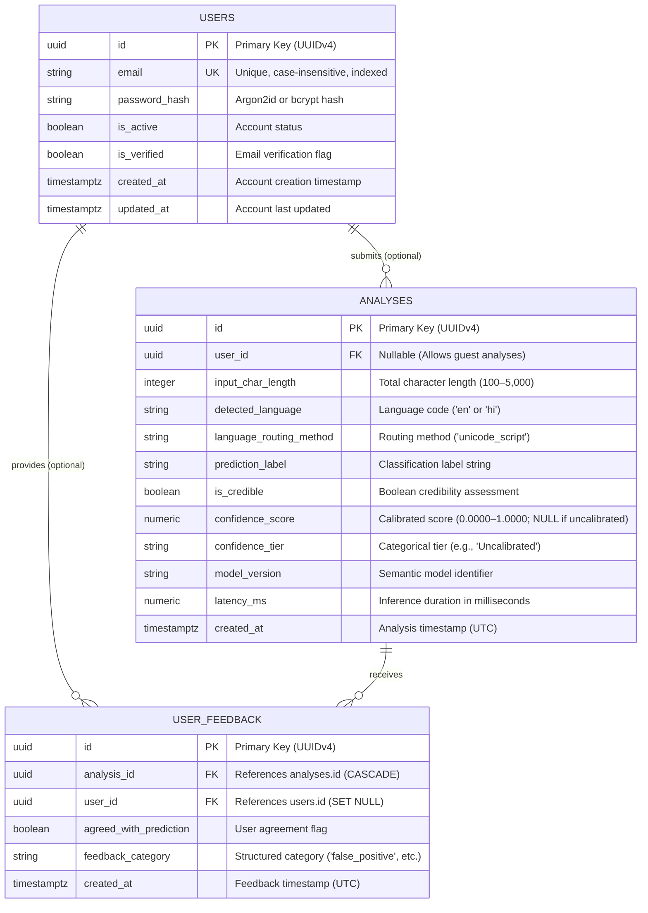

# VeriNews — Relational Database Design & Persistence Specification

**Phase:** P05 Database Design  
**Status:** Documented / Approved Architecture Baseline (Strict Zero-Content-Retention & Privacy Boundary)  
**Target RDBMS:** PostgreSQL 15+ with SQLAlchemy 2.0 ORM & Alembic migrations  
**Target Execution:** Full Application Phase (Post-MVP; Decoupled from MVP `localStorage`)

---

## 1. Architectural Role & Design Principles

In the VeriNews architecture, the database layer serves as a decoupled, optional persistence tier intended for the full production platform. In accordance with the **Ponytail workflow** and research privacy principles:

1. **Decoupled from MVP**: The core ML and NLP inference pipelines remain 100% functional without a database connection. Client-side reading history in the MVP is stored locally on the user's device via browser `localStorage` (last 3–5 items).
2. **Strict Zero Content Retention Principle**: Submitted news texts are **NEVER stored in relational storage**—neither full articles, excerpts/snippets, raw word tokens, nor article-derived feature IDs/weights. The database retains only non-content operational and statistical metadata (such as character count, detected language, classification verdict, model version, latency, and timestamps). Submitted article text exists in volatile server memory only for the duration of inference and is discarded immediately.
3. **Transient Explainability**: Explainability information (influential tokens, feature weights, directional cues) is generated dynamically during inference and returned transiently through the API response (`POST /api/predict`). It is not persisted in the relational database.
4. **Privacy Boundary (Content vs. Account Data)**: Zero Content Retention applies strictly to submitted news text and article-derived features. It is not "zero personal-data collection": the planned `users` table collects standard account credentials (`email` address and `password_hash`) for registered users. Guest users submit no personal account data (`user_id` is null).
5. **Guest Analysis First**: Authentication is never required to analyze news articles. The `user_id` foreign key on the `analyses` entity is strictly nullable.
6. **UUID Identifiers**: All entities utilize cryptographically random UUIDv4 primary keys to prevent enumeration attacks and simplify distributed replication.
7. **UTC Timestamps**: All temporal fields utilize timezone-aware timestamps (`TIMESTAMPTZ`), defaulting to UTC.

---

## 2. Entity-Relationship Diagram

---

## 3. Detailed Entity Definitions

### 3.1 `users` Entity (Future Authentication)
Represents registered users in future releases requiring persistent history across devices. Stores personal account data, separate from news content.

| Column | Data Type | Constraints | Description |
|---|---|---|---|
| `id` | `UUID` | Primary Key, default `gen_random_uuid()` | Unique user identifier. |
| `email` | `VARCHAR(255)` | Not Null, Unique, Indexed | User login email address (personal data; lowercased). |
| `password_hash` | `VARCHAR(255)` | Not Null | Account security credential hash (Argon2id or bcrypt). |
| `is_active` | `BOOLEAN` | Not Null, default `TRUE` | Account active status. |
| `is_verified` | `BOOLEAN` | Not Null, default `FALSE` | Email address verification status. |
| `created_at` | `TIMESTAMPTZ` | Not Null, default `NOW()` | Account creation timestamp. |
| `updated_at` | `TIMESTAMPTZ` | Not Null, default `NOW()` | Profile modification timestamp. |

### 3.2 `analyses` Entity
Represents an individual text analysis request processed by the platform. **Stores strictly non-content operational and statistical metadata. No article text, excerpts, tokens, or feature IDs are persisted.**

| Column | Data Type | Constraints | Description |
|---|---|---|---|
| `id` | `UUID` | Primary Key, default `gen_random_uuid()` | Unique analysis record identifier. |
| `user_id` | `UUID` | Nullable, Foreign Key (`users.id` ON DELETE SET NULL), Indexed | Associated user account, or `NULL` if performed by a guest. |
| `input_char_length` | `INTEGER` | Not Null | Character length of submitted text (100 to 5,000). Scalar metric only. |
| `detected_language` | `VARCHAR(10)` | Not Null | Resolved language code (`en` or `hi`). |
| `language_routing_method` | `VARCHAR(50)` | Not Null | Script routing mechanism (e.g. `unicode_script`). |
| `prediction_label` | `VARCHAR(100)` | Not Null | Human-readable pattern classification label. |
| `is_credible` | `BOOLEAN` | Nullable | Binary flag indicating credibility assessment. |
| `confidence_score` | `NUMERIC(5, 4)` | Nullable | Calibrated probability score (0.0000 to 1.0000). `NULL` if model is uncalibrated. |
| `confidence_tier` | `VARCHAR(50)` | Nullable | Human-readable calibration tier (e.g., `Uncalibrated`). |
| `model_version` | `VARCHAR(50)` | Not Null | SemVer model artifact identifier (e.g. `en-lr-tfidf-v1.0.0`). |
| `latency_ms` | `NUMERIC(8, 2)` | Nullable | End-to-end model execution time in milliseconds. |
| `created_at` | `TIMESTAMPTZ` | Not Null, default `NOW()`, Indexed | Record timestamp (UTC). |

### 3.3 `user_feedback` Entity
Allows end users to flag or provide structured qualitative feedback on pattern classification outputs. **Contains no free-text ingestion field.**

| Column | Data Type | Constraints | Description |
|---|---|---|---|
| `id` | `UUID` | Primary Key, default `gen_random_uuid()` | Unique feedback identifier. |
| `analysis_id` | `UUID` | Not Null, Foreign Key (`analyses.id` ON DELETE CASCADE), Indexed | Target analysis record. |
| `user_id` | `UUID` | Nullable, Foreign Key (`users.id` ON DELETE SET NULL), Indexed | Submitting user, or `NULL` for guest feedback. |
| `agreed_with_prediction` | `BOOLEAN` | Not Null | Whether the reader agreed with the pattern evaluation. |
| `feedback_category` | `VARCHAR(50)` | Not Null | Structured categorization (`false_positive`, `false_negative`, `sensational_tone`, `neutral_reporting`, `other`). |
| `created_at` | `TIMESTAMPTZ` | Not Null, default `NOW()` | Feedback submission timestamp. |

---

## 4. Evaluation of Content Identifiers & Explanation Data

### 4.1 Omission of Article-Derived Explanation Data (`influential_tokens` & `influential_features`)
- **Privacy Trade-Off Analysis**:
  In linear models (such as TF-IDF + Logistic Regression), explanation routines identify words or n-grams with the highest absolute coefficients.
  - If raw word tokens (`influential_tokens`) are stored in relational tables, named entities, proper nouns, and unique keyword combinations from the submitted text are permanently recorded, enabling partial text reconstruction.
  - If vocabulary indices and weights (`influential_features`) are stored, sparse feature vectors can still be correlated against public corpora to infer specific article topics or sentences.
- **Decision**:
  - **No article-derived explanation data is persisted in relational storage.** Neither raw tokens nor feature indices/weights are stored in `analyses`.
  - **Transient API Delivery**: Explainability information is computed dynamically in memory during inference and delivered strictly as a transient payload in the HTTP prediction response (`PredictionResponse`).
  - This guarantees that server-side relational storage holds zero article-derived textual remnants while preserving complete client-side interpretability in the browser UI.

### 4.2 Omission of `input_snippet` and `input_hash`
- **`input_snippet` (Removed)**: Storing the first 500 characters of an article directly violates zero content retention. 500 characters frequently contains complete lead paragraphs. It is omitted.
- **`input_hash` (Omitted)**: Deterministic cryptographic hashing (SHA-256) enables confirmation attacks (querying the hash of a known candidate text to confirm whether/when it was analyzed). Because CPU inference latency is < 10 ms, query caching does not justify introducing a re-identification vector. It is omitted.

### 4.3 Omission of Free-Text Comments (`user_feedback.comment`)
- **Privacy & Security Risk**: Unconstrained comment fields represent an open channel where users might paste full article bodies, confidential excerpts, or Personally Identifiable Information (PII) like names, emails, and phone numbers.
- **Decision**: Omitted from the schema. Model diagnostic feedback is 100% captured using structured enumerations (`agreed_with_prediction: boolean`, `feedback_category: varchar(50)`).
- **Conditional Policy**: If a future business requirement explicitly mandates free-text feedback, it must be capped at 200 characters, subjected to automated regex PII filtering, and governed by a mandatory 30-day auto-purge TTL.

---

## 5. Privacy Boundaries & Data Retention Policies

### 5.1 Zero Content Retention vs. Personal Account Data
A critical distinction exists between news content retention and personal account data:
- **Zero Content Retention (Strict)**: Applies uniformly to all submitted news articles, excerpts, tokens, and feature weights for both guest and authenticated users. The platform retains zero submitted news content.
- **Personal Account Data**: When user accounts are introduced, the platform collects personal account identifiers (`email` address and `password_hash`). This is personal/account data governed by standard privacy principles (GDPR/DPDP), not news content. Zero Content Retention must not be conflated with zero personal-data collection.

### 5.2 Client-Side Storage (`localStorage`) vs. Server-Side Persistence
- **Client-Side Retention**:
  - In the MVP and preview frontend, past analyses (last 3–5 items) are stored locally on the user's device using browser `localStorage`.
  - **Persistence Beyond Active Session**: Unlike `sessionStorage`, `localStorage` persists across browser sessions, tab closures, and device restarts until explicitly cleared by the user or evicted by browser storage policies.
  - **No Automatic Transmission**: Data stored in browser `localStorage` is purely client-local and is **never transmitted to the server automatically**.
  - **User Control**: Users have immediate controls in the UI to clear their local analysis history at any time.
- **Server-Side Storage**:
  - The server persists only non-content operational records (`analyses`) and structured feedback (`user_feedback`).
  - Guest analyses (`user_id = NULL`) are scheduled for automatic rolling deletion after 90 days.
  - Registered user analyses remain until the user manually deletes their account (triggering `ON DELETE SET NULL` anonymization).

---

## 6. Foreign Key Constraints & Cascading Policies

1. **`analyses.user_id` -> `users.id`**:
   - `ON DELETE SET NULL`: If a user deletes their account under right-to-erasure (GDPR/DPDP), analysis records are preserved as anonymized research logs with `user_id = NULL`.
2. **`user_feedback.analysis_id` -> `analyses.id`**:
   - `ON DELETE CASCADE`: If an analysis record is purged or pruned, corresponding user feedback entries are automatically removed.
3. **`user_feedback.user_id` -> `users.id`**:
   - `ON DELETE SET NULL`: Feedback remains tied to the analysis even if the submitting user account is deleted.

---

## 7. Migration & Schema Versioning Strategy

When database persistence is implemented in Phase P07:
- **Tooling**: Alembic will manage schema versions in `backend/alembic/versions/`.
- **Naming Convention**: `YYYYMMDD_HHMM_<description>.py`.
- **Reversibility**: Every migration must define both `upgrade()` and `downgrade()` methods.
- **Session Lifecycle**: Database sessions in FastAPI will be scoped to request lifecycles via dependency injection (`Depends(get_db)`), ensuring connection pool health and automatic rollback on unhandled exceptions.
