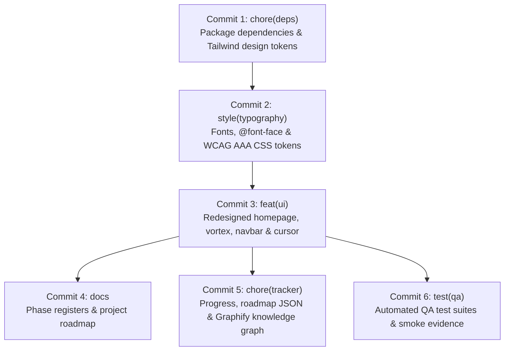

# VeriNews — Complete Git Change Audit & Category-Wise Commit Plan

**Document:** Canonical Release Management & Git Audit Report  
**Role:** Senior Git Release Manager  
**Date:** 2026-11-12  
**Repository:** `VeriNews` (Multilingual Fake News Detection)  
**Current Branch:** `main`  
**Tracking Upstream:** `origin/main` (ahead by 2 unpushed commits)  
**Audit Mode:** Strict Audit-Only (zero staging, zero commits, zero pushes, zero destructive file operations)  

---

## Executive Summary

A comprehensive, file-by-file audit was conducted across the entire VeriNews repository to inspect every changed, modified, deleted, renamed, and untracked file. In total, **190 uncommitted files** (30 modified, 160 untracked) with an aggregate uncommitted footprint of **32.51 MB** were inventoried and classified across all 12 operational categories.

- **Total Uncommitted Changes:** 190 files
  - **Modified Files:** 30 files (Tracked in Git, containing unstaged working tree diffs)
  - **Untracked Files:** 160 files (New files not yet registered in Git index)
  - **Staged Changes:** 0 files (`git diff --cached --stat` returned empty)
- **Existing Outgoing Commits:** 2 commits ahead of `origin/main` (`3528218` and `ef2b0b8`), totaling 1,411 additions and 58 deletions across backend security hardening (SSRF) and QA regression remediation.
- **Recommended for Commit:** 51 essential production and documentation files (~1.8 MB code/docs + optional font assets).
- **Recommended for Exclusion / .gitignore:** 139 files (~30.7 MB), including 80 transient visual regression screenshots (26.3 MB), 23 internal AST compiler caches (2.7 MB), 11 scratch development scripts (47 KB), duplicate font binaries, and invalid config stubs.

---

## Category-Wise Distribution Matrix

| Category ID | Category Name | Total Files | Modified | Untracked | Aggregate Size | Release Recommendation |
| :--- | :--- | :---: | :---: | :---: | :---: | :--- |
| **01** | Frontend UI & Components | 25 | 10 | 15 | 212.3 KB | **Commit (23 files) / Exclude (2 files)** |
| **02** | Design System, CSS & Typography | 1 | 1 | 0 | 7.2 KB | **Commit (1 file)** |
| **03 / 12** | Fonts, Static Assets & Licensing | 16 | 0 | 16 | 2.49 MB | **Conditional Commit (8 files) / Exclude Duplicates (8 files)** |
| **04** | Dependencies & Configuration | 5 | 3 | 2 | 243.3 KB | **Commit (3 files) / Exclude Stubs (2 files)** |
| **05** | Backend & API | 2 | 2 | 0 | 11.9 KB | **Exclude / Local Scratch (2 files)** |
| **06** | ML/NLP & Datasets | 0 | 0 | 0 | 0 B | **Clean / Excluded via .gitignore** |
| **07** | Documentation & Roadmap | 2 | 0 | 2 | 44.9 KB | **Commit (2 files)** |
| **08** | Project Trackers & Graphify | 34 | 11 | 23 | 3.01 MB | **Commit Core (11 files) / Exclude AST Cache (23 files)** |
| **09** | Testing & QA Scripts | 11 | 0 | 11 | 168.5 KB | **Commit (11 files)** |
| **10** | Screenshots & Visual Evidence | 83 | 3 | 80 | 26.30 MB | **Commit Core Smoke (3 files) / Exclude Bulk (80 files)** |
| **11** | Temporary & Generated Files | 11 | 0 | 11 | 47.3 KB | **Exclude / Add to .gitignore (11 files)** |
| **TOTAL** | **Full Repository Inventory** | **190** | **30** | **160** | **32.51 MB** | **51 Recommended / 139 Excluded** |

---

## Existing Outgoing Commits (Ahead of origin/main)

The local `main` branch is ahead of `origin/main` by 2 commits:

```text
ef2b0b8 fix(backend): resolve VN-01, VN-02, VN-03, VN-05, VN-07, VN-08 and VN-09 QA regressions
3528218 fix(security): remediate VN-04 SSRF vulnerabilities and harden URL extraction
```

### Commit 1: `3528218` — VN-04 SSRF Remediation
- **Files Modified:**
  - `backend/app/services/url_extractor.py` (+365 / -42)
  - `backend/requirements.txt` (+1)
  - `backend/tests/test_ssrf_remediation.py` (+683)
- **Summary:** Implemented strict domain validation, DNS resolution pinning, loopback/link-local/private IP blocking (RFC 1918 / RFC 3927 / RFC 4193), redirect limits, and comprehensive unit tests.

### Commit 2: `ef2b0b8` — Backend QA Regressions (VN-01 to VN-09)
- **Files Modified:**
  - `backend/app/api/routes.py` (+12 / -16)
  - `backend/app/services/evidence_analyzer.py` (+61 / -1)
  - `backend/app/services/language.py` (+71 / -1)
  - `backend/app/services/web_search.py` (+32 / -12)
  - `backend/tests/test_qa_regression.py` (+244)
- **Summary:** Resolved Hindi language detection thresholds, claim extraction fallbacks, timeout handling, and web evidence consistency.

---

## Licensing, Security & Binary Assets Audit

### 1. Font Licensing Compliance & EULA Constraints
- **Brunson Font Family:**
  - Found in `frontend/public/fonts/brunson/`: `Brunson.ttf` (38.3 KB) and `Brunson-Rough.ttf` (1.58 MB).
  - `LICENSE_NOTICE.txt`: `(c) The Branded Quotes 2025. All Rights Reserved. Commercial license required for commercial release.`
  - **Risk:** High if pushed to public commercial production without license key/invoice documentation.
  - **Recommendation:** Stage `Brunson.ttf`, `Brunson-Rough.ttf`, and `LICENSE_NOTICE.txt` only under explicit mentor/owner confirmation.
- **Heading Now Trial Font Family:**
  - Found in `frontend/public/fonts/heading-now/`: `HeadingNow-48Heavy.ttf` (231.5 KB), `HeadingNow-58Heavy.ttf` (258.7 KB), and `Heading Now Family (CC BY-NC)License.pdf` (224.2 KB).
  - `LICENSE_NOTICE.txt`: `Creative Commons Attribution-NonCommercial (CC BY-NC) / EULA Trial. Commercial website deployment requires purchasing a commercial webfont license from Zetafonts.`
  - **Compliance Status:** Complies with non-commercial academic research release; commercial deployment requires license upgrade.
- **Impact Font:**
  - `Impact.ttf` (45.4 KB) and `Impact-Extravagant.ttf` (22.9 KB). Monotype/Microsoft desktop core font. Used for non-hero display headings.

### 2. Duplicate Font Files (Immediate Pruning Candidates)
- `frontend/public/fonts/impact/Impact.ttf` (45.4 KB) is an exact duplicate of `frontend/public/fonts/Impact.ttf`.
- `frontend/public/fonts/impact/Impact-Extravagant.ttf` (22.9 KB) is an exact duplicate of `frontend/public/fonts/Impact-Extravagant.ttf`.
- `scratch/impact_extracted/Impact.ttf` & `Impact-Extravagant.ttf` are duplicate extracted files.
- `frontend/src/app/fonts/One Slice.otf` (35.9 KB) and `frontend/src/app/fonts/OneSlice.otf` (35.9 KB) are identical duplicates of the superseded One Slice font. Completely replaced by Brunson/Heading Now/Impact and never imported in active code.

### 3. Security, Credentials & Secret Verification
- **`.env` files:** Zero `.env` files appear in `git status`. Verified `.gitignore` actively ignores `.env`, `.env.*` (except `.env.example`).
- **API Keys & Secrets:** Neither `components.json` nor `frontend/components.json` exposes a secret key. Both use shell expansion `${REACTBITS_LICENSE_KEY}`.
- **Electric Arc Cursor:** Independently developed via Canvas 2D (`frontend/src/components/ui/electric-arc-cursor.tsx`) without any external proprietary React Bits Pro dependencies or license keys.

### 4. Large Binaries & Repository Bloat Assessment
- `scripts/screenshots/` contains 83 uncommitted PNG screenshots totaling **26.30 MB**.
- `graphify-out/cache/ast/` contains 23 compiler cache AST JSON files totaling **2.74 MB**.
- Committing all 83 screenshots and 23 AST cache files would permanently inflate repository clone time by >29 MB.
- **Recommendation:** Commit only the 3 updated core smoke screenshots (`mvp_smoke_*.png`, 307 KB) and exclude transient phase QA screenshots via `.gitignore`.

---

## Configuration Files Audit

1. **`frontend/package.json` & `frontend/package-lock.json`:**
   - Adds runtime dependencies `three`, `gsap`, `lenis`, and `zod` plus dev dependency `@types/three`.
   - Actively used across `SmoothScrollProvider`, `segmented-control`, `liquid-glass-button`, `interactive-neural-vortex-background`, and schema validators.
   - **Verdict:** REQUIRED. Staged in Commit 1.
2. **`frontend/tailwind.config.js`:**
   - Maps design system font families (`brunson`, `heading-now`, `impact`, `display`), brand color tokens, and shadow glow utilities.
   - **Verdict:** REQUIRED. Staged in Commit 1.
3. **`components.json` (root directory):**
   - Unused configuration referencing non-existent `frontend/tailwind.config.ts`. The repository root is not a Next.js workspace.
   - **Verdict:** INVALID / EXCLUDE. Delete or ignore.
4. **`frontend/components.json`:**
   - Created during ReactBits Pro experimentation. Not required by any active application code.
   - **Verdict:** EXCLUDE / IGNORE.

---

## Complete 190-File Audit Inventory

Every single uncommitted file in the repository appears exactly once in the table below:

| Index | File Path | Git Status | Size | Category | Recommendation | Operational Note |
| :---: | :--- | :---: | :---: | :--- | :--- | :--- |
| 1 | `frontend/package-lock.json` | Modified | 238.2 KB | 4. Dependencies and configuration | **Commit (Commit 1: chore(deps))** | Required frontend runtime dependencies and Tailwind tokens |
| 2 | `frontend/package.json` | Modified | 865 B | 4. Dependencies and configuration | **Commit (Commit 1: chore(deps))** | Required frontend runtime dependencies and Tailwind tokens |
| 3 | `frontend/src/App.tsx` | Modified | 15.4 KB | 1. Frontend UI and components | **Commit (Commit 3: feat(ui))** | Core redesigned UI component |
| 4 | `frontend/src/app/globals.css` | Modified | 7.2 KB | 2. Design system, CSS and typography | **Commit (Commit 2: style(typography))** | Global theme variables, font-face, and WCAG AAA tokens |
| 5 | `frontend/src/app/layout.tsx` | Modified | 2.0 KB | 1. Frontend UI and components | **Commit (Commit 3: feat(ui))** | Core redesigned UI component |
| 6 | `frontend/src/app/project-tracker/page.tsx` | Modified | 377 B | 1. Frontend UI and components | **Commit (Commit 3: feat(ui))** | Core redesigned UI component |
| 7 | `frontend/src/app/project-tracker/tracker-dashboard.tsx` | Modified | 31.9 KB | 1. Frontend UI and components | **Commit (Commit 3: feat(ui))** | Core redesigned UI component |
| 8 | `frontend/src/components/AnalysisResult.tsx` | Modified | 14.8 KB | 1. Frontend UI and components | **Commit (Commit 3: feat(ui))** | Core redesigned UI component |
| 9 | `frontend/src/components/Analyzer.tsx` | Modified | 20.2 KB | 1. Frontend UI and components | **Commit (Commit 3: feat(ui))** | Core redesigned UI component |
| 10 | `frontend/src/components/Icon.tsx` | Modified | 3.4 KB | 1. Frontend UI and components | **Commit (Commit 3: feat(ui))** | Core redesigned UI component |
| 11 | `frontend/src/components/InfoModal.tsx` | Modified | 19.4 KB | 1. Frontend UI and components | **Commit (Commit 3: feat(ui))** | Core redesigned UI component |
| 12 | `frontend/src/components/NavBar.tsx` | Modified | 8.6 KB | 1. Frontend UI and components | **Commit (Commit 3: feat(ui))** | Core redesigned UI component |
| 13 | `frontend/src/components/ThemeToggle.tsx` | Modified | 258 B | 1. Frontend UI and components | **Commit (Commit 3: feat(ui))** | Core redesigned UI component |
| 14 | `frontend/tailwind.config.js` | Modified | 2.7 KB | 4. Dependencies and configuration | **Commit (Commit 1: chore(deps))** | Required frontend runtime dependencies and Tailwind tokens |
| 15 | `graphify-out/.graphify_build_state.json` | Modified | 407 B | 8. Project trackers and Graphify | **Commit (Commit 5: chore(tracker))** | Machine-readable project tracker & Graphify sync |
| 16 | `graphify-out/.graphify_labels.json.sig` | Modified | 2.2 KB | 8. Project trackers and Graphify | **Commit (Commit 5: chore(tracker))** | Machine-readable project tracker & Graphify sync |
| 17 | `graphify-out/.graphify_labels.pending.json` | Modified | 2.7 KB | 8. Project trackers and Graphify | **Commit (Commit 5: chore(tracker))** | Machine-readable project tracker & Graphify sync |
| 18 | `graphify-out/GRAPH_REPORT.md` | Modified | 19.8 KB | 8. Project trackers and Graphify | **Commit (Commit 5: chore(tracker))** | Machine-readable project tracker & Graphify sync |
| 19 | `graphify-out/cache/last_query_stamp` | Modified | 16 B | 8. Project trackers and Graphify | **Commit (Commit 5: chore(tracker))** | Machine-readable project tracker & Graphify sync |
| 20 | `graphify-out/cache/stat-index.json` | Modified | 48.3 KB | 8. Project trackers and Graphify | **Commit (Commit 5: chore(tracker))** | Machine-readable project tracker & Graphify sync |
| 21 | `graphify-out/graph.html` | Modified | 1.27 MB | 8. Project trackers and Graphify | **Commit (Commit 5: chore(tracker))** | Machine-readable project tracker & Graphify sync |
| 22 | `graphify-out/graph.json` | Modified | 1.19 MB | 8. Project trackers and Graphify | **Commit (Commit 5: chore(tracker))** | Machine-readable project tracker & Graphify sync |
| 23 | `graphify-out/manifest.json` | Modified | 58.1 KB | 8. Project trackers and Graphify | **Commit (Commit 5: chore(tracker))** | Machine-readable project tracker & Graphify sync |
| 24 | `project-tracker/progress.json` | Modified | 35.2 KB | 8. Project trackers and Graphify | **Commit (Commit 5: chore(tracker))** | Machine-readable project tracker & Graphify sync |
| 25 | `project-tracker/roadmap.json` | Modified | 13.2 KB | 8. Project trackers and Graphify | **Commit (Commit 5: chore(tracker))** | Machine-readable project tracker & Graphify sync |
| 26 | `scratch/test_gemini_backend.py` | Modified | 4.6 KB | 5. Backend and API | **Exclude / Local Scratch** | Scratch verification test for Gemini backend |
| 27 | `scratch/test_gemini_request.py` | Modified | 7.2 KB | 5. Backend and API | **Exclude / Local Scratch** | Scratch verification test for Gemini backend |
| 28 | `scripts/screenshots/mvp_smoke_01_english_headline.png` | Modified | 100.2 KB | 10. Screenshots and visual evidence | **Commit (Commit 6: test(qa))** | Tracked core smoke test evidence |
| 29 | `scripts/screenshots/mvp_smoke_02_hindi_headline.png` | Modified | 100.2 KB | 10. Screenshots and visual evidence | **Commit (Commit 6: test(qa))** | Tracked core smoke test evidence |
| 30 | `scripts/screenshots/mvp_smoke_05_news_url.png` | Modified | 100.2 KB | 10. Screenshots and visual evidence | **Commit (Commit 6: test(qa))** | Tracked core smoke test evidence |
| 31 | `components.json` | Untracked | 833 B | 4. Dependencies and configuration | **Exclude / Delete** | Invalid root config (points to missing .ts) |
| 32 | `docs/PHASE_STATUS.md` | Untracked | 38.4 KB | 7. Documentation and roadmap | **Commit (Commit 4: docs)** | Authoritative phase registers and roadmap |
| 33 | `docs/ROADMAP.md` | Untracked | 6.5 KB | 7. Documentation and roadmap | **Commit (Commit 4: docs)** | Authoritative phase registers and roadmap |
| 34 | `frontend/components.json` | Untracked | 815 B | 4. Dependencies and configuration | **Exclude / Ignore** | References ReactBits Pro registry (not used) |
| 35 | `frontend/public/fonts/Impact-Extravagant.ttf` | Untracked | 22.4 KB | 12. Sensitive, licensed or restricted files | **Conditional Commit (Commit 2)** | Restricted font binary (requires mentor/owner license sign-off) |
| 36 | `frontend/public/fonts/Impact.ttf` | Untracked | 44.3 KB | 12. Sensitive, licensed or restricted files | **Conditional Commit (Commit 2)** | Restricted font binary (requires mentor/owner license sign-off) |
| 37 | `frontend/public/fonts/brunson/Brunson-Rough.ttf` | Untracked | 1.50 MB | 12. Sensitive, licensed or restricted files | **Conditional Commit (Commit 2)** | Restricted font binary (requires mentor/owner license sign-off) |
| 38 | `frontend/public/fonts/brunson/Brunson.ttf` | Untracked | 37.4 KB | 12. Sensitive, licensed or restricted files | **Conditional Commit (Commit 2)** | Restricted font binary (requires mentor/owner license sign-off) |
| 39 | `frontend/public/fonts/brunson/LICENSE_NOTICE.txt` | Untracked | 210 B | 12. Sensitive, licensed or restricted files | **Commit (Commit 2: style(typography))** | Mandatory license compliance notices |
| 40 | `frontend/public/fonts/heading-now/Heading Now Family (CC BY-NC)License.pdf` | Untracked | 219.0 KB | 12. Sensitive, licensed or restricted files | **Commit (Commit 2: style(typography))** | Mandatory license compliance notices |
| 41 | `frontend/public/fonts/heading-now/HeadingNow-48Heavy.ttf` | Untracked | 226.0 KB | 12. Sensitive, licensed or restricted files | **Conditional Commit (Commit 2)** | Restricted font binary (requires mentor/owner license sign-off) |
| 42 | `frontend/public/fonts/heading-now/HeadingNow-58Heavy.ttf` | Untracked | 252.6 KB | 12. Sensitive, licensed or restricted files | **Conditional Commit (Commit 2)** | Restricted font binary (requires mentor/owner license sign-off) |
| 43 | `frontend/public/fonts/heading-now/LICENSE_NOTICE.txt` | Untracked | 369 B | 12. Sensitive, licensed or restricted files | **Commit (Commit 2: style(typography))** | Mandatory license compliance notices |
| 44 | `frontend/public/fonts/impact/Impact-Extravagant.ttf` | Untracked | 22.4 KB | 12. Sensitive, licensed or restricted files | **Exclude / Delete** | Exact duplicate of root fonts/ Impact files |
| 45 | `frontend/public/fonts/impact/Impact.ttf` | Untracked | 44.3 KB | 12. Sensitive, licensed or restricted files | **Exclude / Delete** | Exact duplicate of root fonts/ Impact files |
| 46 | `frontend/src/app/fonts/One Slice.otf` | Untracked | 22.4 KB | 12. Sensitive, licensed or restricted files | **Exclude / Delete** | Superseded legacy font duplicate |
| 47 | `frontend/src/app/fonts/OneSlice.otf` | Untracked | 22.4 KB | 12. Sensitive, licensed or restricted files | **Exclude / Delete** | Superseded legacy font duplicate |
| 48 | `frontend/src/components/Footer.tsx` | Untracked | 6.5 KB | 1. Frontend UI and components | **Commit (Commit 3: feat(ui))** | Core redesigned UI component |
| 49 | `frontend/src/components/features/TransparencySection.tsx` | Untracked | 6.2 KB | 1. Frontend UI and components | **Commit (Commit 3: feat(ui))** | Core redesigned UI component |
| 50 | `frontend/src/components/features/WhyVeriNewsSection.tsx` | Untracked | 5.6 KB | 1. Frontend UI and components | **Commit (Commit 3: feat(ui))** | Core redesigned UI component |
| 51 | `frontend/src/components/hero/HeroSection.tsx` | Untracked | 7.4 KB | 1. Frontend UI and components | **Commit (Commit 3: feat(ui))** | Core redesigned UI component |
| 52 | `frontend/src/components/hero/ParticleWaveCanvas.tsx` | Untracked | 13.2 KB | 1. Frontend UI and components | **Exclude / Archive** | Superseded Phase 2 canvas (replaced by Neural Vortex) |
| 53 | `frontend/src/components/providers/SmoothScrollProvider.tsx` | Untracked | 1.9 KB | 1. Frontend UI and components | **Commit (Commit 3: feat(ui))** | Core redesigned UI component |
| 54 | `frontend/src/components/ui/GlassCard.tsx` | Untracked | 1.3 KB | 1. Frontend UI and components | **Commit (Commit 3: feat(ui))** | Core redesigned UI component |
| 55 | `frontend/src/components/ui/MagneticButton.tsx` | Untracked | 2.9 KB | 1. Frontend UI and components | **Commit (Commit 3: feat(ui))** | Core redesigned UI component |
| 56 | `frontend/src/components/ui/PillBadge.tsx` | Untracked | 2.2 KB | 1. Frontend UI and components | **Commit (Commit 3: feat(ui))** | Core redesigned UI component |
| 57 | `frontend/src/components/ui/cinematic-theme-switcher.tsx` | Untracked | 5.7 KB | 1. Frontend UI and components | **Commit (Commit 3: feat(ui))** | Core redesigned UI component |
| 58 | `frontend/src/components/ui/demo.tsx` | Untracked | 180 B | 1. Frontend UI and components | **Exclude / Delete** | Unused test demo component |
| 59 | `frontend/src/components/ui/electric-arc-cursor.tsx` | Untracked | 16.8 KB | 1. Frontend UI and components | **Commit (Commit 3: feat(ui))** | Core redesigned UI component |
| 60 | `frontend/src/components/ui/interactive-neural-vortex-background.tsx` | Untracked | 14.3 KB | 1. Frontend UI and components | **Commit (Commit 3: feat(ui))** | Core redesigned UI component |
| 61 | `frontend/src/components/ui/liquid-glass-button.tsx` | Untracked | 4.5 KB | 1. Frontend UI and components | **Commit (Commit 3: feat(ui))** | Core redesigned UI component |
| 62 | `frontend/src/components/ui/segmented-control.tsx` | Untracked | 7.3 KB | 1. Frontend UI and components | **Commit (Commit 3: feat(ui))** | Core redesigned UI component |
| 63 | `graphify-out/cache/ast/v0.9.105-s42-gec1ecb915443/0a911eef6a417d0826d4419e7677138962e1284536943080e2ae078a3131c3a0.json` | Untracked | 74 B | 8. Project trackers and Graphify | **Exclude / .gitignore** | Transient internal AST compiler cache |
| 64 | `graphify-out/cache/ast/v0.9.105-s42-gec1ecb915443/0cd8fbad91e34cf6b49dbee4458ab020aba311e7921c03b8a5f5f596223ac105.json` | Untracked | 74 B | 8. Project trackers and Graphify | **Exclude / .gitignore** | Transient internal AST compiler cache |
| 65 | `graphify-out/cache/ast/v0.9.105-s42-gec1ecb915443/11cc66f5c3dc3f1ceb3d68106bafa8c08ab7480090dc667f81fa8b88d94bc501.json` | Untracked | 1.6 KB | 8. Project trackers and Graphify | **Exclude / .gitignore** | Transient internal AST compiler cache |
| 66 | `graphify-out/cache/ast/v0.9.105-s42-gec1ecb915443/28b6bfd5ad3aa163669eb6fa5cdaaef98534b67d7e84f06b00628a473724d61d.json` | Untracked | 6.9 KB | 8. Project trackers and Graphify | **Exclude / .gitignore** | Transient internal AST compiler cache |
| 67 | `graphify-out/cache/ast/v0.9.105-s42-gec1ecb915443/2d5a08cdbe5c9e4d0dd53de22bb32c0a045bf3b70c323672052e01c0129bc157.json` | Untracked | 43.8 KB | 8. Project trackers and Graphify | **Exclude / .gitignore** | Transient internal AST compiler cache |
| 68 | `graphify-out/cache/ast/v0.9.105-s42-gec1ecb915443/2e523a191ca030d79ec4b3b9b735e604ad2118478681902dc02be3a161ad42f5.json` | Untracked | 74 B | 8. Project trackers and Graphify | **Exclude / .gitignore** | Transient internal AST compiler cache |
| 69 | `graphify-out/cache/ast/v0.9.105-s42-gec1ecb915443/3c5f33e703732cce7c8d30d7429b38b498d490c329c07aa17195ed53aea0ea24.json` | Untracked | 23.7 KB | 8. Project trackers and Graphify | **Exclude / .gitignore** | Transient internal AST compiler cache |
| 70 | `graphify-out/cache/ast/v0.9.105-s42-gec1ecb915443/4c6711c211919ed5536723ccfda33b530eb16b31f783a582a53eb6096a1c7612.json` | Untracked | 1.6 KB | 8. Project trackers and Graphify | **Exclude / .gitignore** | Transient internal AST compiler cache |
| 71 | `graphify-out/cache/ast/v0.9.105-s42-gec1ecb915443/4dafcbc284e0647b73d8fb7210feac62829f38aee6a6e9723035182b9974cf08.json` | Untracked | 74 B | 8. Project trackers and Graphify | **Exclude / .gitignore** | Transient internal AST compiler cache |
| 72 | `graphify-out/cache/ast/v0.9.105-s42-gec1ecb915443/4e20020ec33562596b2d69a3b3645dddda6fdf9ca254946238573cc2b34e2ff9.json` | Untracked | 7.6 KB | 8. Project trackers and Graphify | **Exclude / .gitignore** | Transient internal AST compiler cache |
| 73 | `graphify-out/cache/ast/v0.9.105-s42-gec1ecb915443/537d79f6e75ac410b36ec90ff9c7bb092d519d74c219f154737c284cd699fe08.json` | Untracked | 2.1 KB | 8. Project trackers and Graphify | **Exclude / .gitignore** | Transient internal AST compiler cache |
| 74 | `graphify-out/cache/ast/v0.9.105-s42-gec1ecb915443/6159e31f0b0ee5a82182d5548bedbce240ba048c31536f0b8ca9a74a64ce0d48.json` | Untracked | 31.4 KB | 8. Project trackers and Graphify | **Exclude / .gitignore** | Transient internal AST compiler cache |
| 75 | `graphify-out/cache/ast/v0.9.105-s42-gec1ecb915443/742e6e9f9b268cccd6aeb1085b4af453f0d95c15511b7a5b7bd7a80adef8f31f.json` | Untracked | 24.7 KB | 8. Project trackers and Graphify | **Exclude / .gitignore** | Transient internal AST compiler cache |
| 76 | `graphify-out/cache/ast/v0.9.105-s42-gec1ecb915443/7b82860a4b4f67f70b39ccd244cb18b5c4260813c4e432140c80bcc33562d339.json` | Untracked | 30.2 KB | 8. Project trackers and Graphify | **Exclude / .gitignore** | Transient internal AST compiler cache |
| 77 | `graphify-out/cache/ast/v0.9.105-s42-gec1ecb915443/9aadced26a62bf0b102a226cd90f278050ff66ccaf9ec49d568ed3c6a13b5123.json` | Untracked | 33.3 KB | 8. Project trackers and Graphify | **Exclude / .gitignore** | Transient internal AST compiler cache |
| 78 | `graphify-out/cache/ast/v0.9.105-s42-gec1ecb915443/a46a59655fd13374b5973ea9e6903431f0a183a59f95316cc00994f2f3965763.json` | Untracked | 74 B | 8. Project trackers and Graphify | **Exclude / .gitignore** | Transient internal AST compiler cache |
| 79 | `graphify-out/cache/ast/v0.9.105-s42-gec1ecb915443/b8d2956cf3c41c12b4285d4be2bbfa53a4e5b63f25daeb5b0d09435e97164e8f.json` | Untracked | 20.6 KB | 8. Project trackers and Graphify | **Exclude / .gitignore** | Transient internal AST compiler cache |
| 80 | `graphify-out/cache/ast/v0.9.105-s42-gec1ecb915443/c65a5156f8218b68d91d69d11c8028bb0c71c00a5f22bbc09d8b7954056e2f8d.json` | Untracked | 106.0 KB | 8. Project trackers and Graphify | **Exclude / .gitignore** | Transient internal AST compiler cache |
| 81 | `graphify-out/cache/ast/v0.9.105-s42-gec1ecb915443/cd07b8eb800a63174644ea939e3c4dbbb8c5a02e7f3795079e3cd1ad2c01ed51.json` | Untracked | 20.6 KB | 8. Project trackers and Graphify | **Exclude / .gitignore** | Transient internal AST compiler cache |
| 82 | `graphify-out/cache/ast/v0.9.105-s42-gec1ecb915443/dd4a387931756416519892461ccbc17a5d3fa915fcc045d2afc4bdfdb7deec2a.json` | Untracked | 3.6 KB | 8. Project trackers and Graphify | **Exclude / .gitignore** | Transient internal AST compiler cache |
| 83 | `graphify-out/cache/ast/v0.9.105-s42-gec1ecb915443/dfd71918a2ea7b0f1d6afd93b3aa5ed97d33683de5e46bd68b22f087470dcb93.json` | Untracked | 74 B | 8. Project trackers and Graphify | **Exclude / .gitignore** | Transient internal AST compiler cache |
| 84 | `graphify-out/cache/ast/v0.9.105-s42-gec1ecb915443/e50c7e7a58cbc1076f4004654fd3ad29b0d6cb48ac66c1afc967f31cdb8165d0.json` | Untracked | 12.2 KB | 8. Project trackers and Graphify | **Exclude / .gitignore** | Transient internal AST compiler cache |
| 85 | `graphify-out/cache/ast/v0.9.105-s42-gec1ecb915443/f69815ba3de6b67aea6993c70b904afca809ef8c59fbc0cdb4ec30d523a731ce.json` | Untracked | 8.8 KB | 8. Project trackers and Graphify | **Exclude / .gitignore** | Transient internal AST compiler cache |
| 86 | `scratch/audit_consistency.mjs` | Untracked | 2.5 KB | 11. Temporary/generated files | **Exclude / .gitignore** | Local scratch scripts and font utilities |
| 87 | `scratch/capture_nav_and_vortex.mjs` | Untracked | 7.8 KB | 11. Temporary/generated files | **Exclude / .gitignore** | Local scratch scripts and font utilities |
| 88 | `scratch/check_last_user_input.js` | Untracked | 779 B | 11. Temporary/generated files | **Exclude / .gitignore** | Local scratch scripts and font utilities |
| 89 | `scratch/extract_font.ps1` | Untracked | 501 B | 11. Temporary/generated files | **Exclude / .gitignore** | Local scratch scripts and font utilities |
| 90 | `scratch/extract_fonts.js` | Untracked | 1.0 KB | 11. Temporary/generated files | **Exclude / .gitignore** | Local scratch scripts and font utilities |
| 91 | `scratch/impact.zip` | Untracked | 28.9 KB | 12. Sensitive, licensed or restricted files | **Exclude / .gitignore** | Temporary zip and extracted font copies |
| 92 | `scratch/impact_extracted/Impact-Extravagant.ttf` | Untracked | 22.4 KB | 12. Sensitive, licensed or restricted files | **Exclude / .gitignore** | Temporary zip and extracted font copies |
| 93 | `scratch/impact_extracted/Impact.ttf` | Untracked | 44.3 KB | 12. Sensitive, licensed or restricted files | **Exclude / .gitignore** | Temporary zip and extracted font copies |
| 94 | `scratch/install_fonts.js` | Untracked | 2.1 KB | 11. Temporary/generated files | **Exclude / .gitignore** | Local scratch scripts and font utilities |
| 95 | `scratch/parse_ttf_names.js` | Untracked | 1.5 KB | 11. Temporary/generated files | **Exclude / .gitignore** | Local scratch scripts and font utilities |
| 96 | `scratch/run_acceptance_audit.py` | Untracked | 13.0 KB | 11. Temporary/generated files | **Exclude / .gitignore** | Local scratch scripts and font utilities |
| 97 | `scratch/update_phase_status.mjs` | Untracked | 3.9 KB | 11. Temporary/generated files | **Exclude / .gitignore** | Local scratch scripts and font utilities |
| 98 | `scratch/update_trackers.mjs` | Untracked | 5.2 KB | 11. Temporary/generated files | **Exclude / .gitignore** | Local scratch scripts and font utilities |
| 99 | `scratch/verify_typography_and_contrast.mjs` | Untracked | 9.1 KB | 11. Temporary/generated files | **Exclude / .gitignore** | Local scratch scripts and font utilities |
| 100 | `scripts/audit_remediation_evidence.mjs` | Untracked | 3.3 KB | 9. Testing and QA scripts | **Commit (Commit 6: test(qa))** | Automated browser QA, vitals and regression test suite |
| 101 | `scripts/measure_web_vitals.mjs` | Untracked | 7.7 KB | 9. Testing and QA scripts | **Commit (Commit 6: test(qa))** | Automated browser QA, vitals and regression test suite |
| 102 | `scripts/screenshots/adaptive_vortex_01_dark_1440.png` | Untracked | 301.9 KB | 10. Screenshots and visual evidence | **Exclude / .gitignore** | Transient visual test screenshots (~27 MB) |
| 103 | `scripts/screenshots/adaptive_vortex_02_light_1440.png` | Untracked | 227.7 KB | 10. Screenshots and visual evidence | **Exclude / .gitignore** | Transient visual test screenshots (~27 MB) |
| 104 | `scripts/screenshots/adaptive_vortex_03_light_mobile_375.png` | Untracked | 192.5 KB | 10. Screenshots and visual evidence | **Exclude / .gitignore** | Transient visual test screenshots (~27 MB) |
| 105 | `scripts/screenshots/adaptive_vortex_04_dark_mobile_375.png` | Untracked | 254.2 KB | 10. Screenshots and visual evidence | **Exclude / .gitignore** | Transient visual test screenshots (~27 MB) |
| 106 | `scripts/screenshots/arc_cursor_01_dark_motion_trail.png` | Untracked | 298.8 KB | 10. Screenshots and visual evidence | **Exclude / .gitignore** | Transient visual test screenshots (~27 MB) |
| 107 | `scripts/screenshots/arc_cursor_02_dark_click_discharge.png` | Untracked | 344.5 KB | 10. Screenshots and visual evidence | **Exclude / .gitignore** | Transient visual test screenshots (~27 MB) |
| 108 | `scripts/screenshots/arc_cursor_03_light_motion_trail.png` | Untracked | 228.9 KB | 10. Screenshots and visual evidence | **Exclude / .gitignore** | Transient visual test screenshots (~27 MB) |
| 109 | `scripts/screenshots/arc_cursor_04_light_click_discharge.png` | Untracked | 235.2 KB | 10. Screenshots and visual evidence | **Exclude / .gitignore** | Transient visual test screenshots (~27 MB) |
| 110 | `scripts/screenshots/arc_cursor_05_mobile_touch.png` | Untracked | 204.3 KB | 10. Screenshots and visual evidence | **Exclude / .gitignore** | Transient visual test screenshots (~27 MB) |
| 111 | `scripts/screenshots/nav_liquid_glass_dark_1440.png` | Untracked | 400.2 KB | 10. Screenshots and visual evidence | **Exclude / .gitignore** | Transient visual test screenshots (~27 MB) |
| 112 | `scripts/screenshots/nav_liquid_glass_light_1440.png` | Untracked | 239.8 KB | 10. Screenshots and visual evidence | **Exclude / .gitignore** | Transient visual test screenshots (~27 MB) |
| 113 | `scripts/screenshots/nav_liquid_glass_mobile_375.png` | Untracked | 207.8 KB | 10. Screenshots and visual evidence | **Exclude / .gitignore** | Transient visual test screenshots (~27 MB) |
| 114 | `scripts/screenshots/nav_liquid_glass_pill_dark.png` | Untracked | 20.3 KB | 10. Screenshots and visual evidence | **Exclude / .gitignore** | Transient visual test screenshots (~27 MB) |
| 115 | `scripts/screenshots/nav_liquid_glass_pill_light.png` | Untracked | 11.8 KB | 10. Screenshots and visual evidence | **Exclude / .gitignore** | Transient visual test screenshots (~27 MB) |
| 116 | `scripts/screenshots/nav_segmented_control_crop.png` | Untracked | 14.8 KB | 10. Screenshots and visual evidence | **Exclude / .gitignore** | Transient visual test screenshots (~27 MB) |
| 117 | `scripts/screenshots/nav_vortex_refined_dark_1440.png` | Untracked | 319.0 KB | 10. Screenshots and visual evidence | **Exclude / .gitignore** | Transient visual test screenshots (~27 MB) |
| 118 | `scripts/screenshots/phase1_qa_01_glasscard_light.png` | Untracked | 102.1 KB | 10. Screenshots and visual evidence | **Exclude / .gitignore** | Transient visual test screenshots (~27 MB) |
| 119 | `scripts/screenshots/phase1_qa_02_glasscard_dark.png` | Untracked | 186.4 KB | 10. Screenshots and visual evidence | **Exclude / .gitignore** | Transient visual test screenshots (~27 MB) |
| 120 | `scripts/screenshots/phase1_qa_03_pillbadges.png` | Untracked | 186.4 KB | 10. Screenshots and visual evidence | **Exclude / .gitignore** | Transient visual test screenshots (~27 MB) |
| 121 | `scripts/screenshots/phase1_qa_04_magnetic_button.png` | Untracked | 188.5 KB | 10. Screenshots and visual evidence | **Exclude / .gitignore** | Transient visual test screenshots (~27 MB) |
| 122 | `scripts/screenshots/phase1_qa_05_custom_cursor.png` | Untracked | 82.5 KB | 10. Screenshots and visual evidence | **Exclude / .gitignore** | Transient visual test screenshots (~27 MB) |
| 123 | `scripts/screenshots/phase1_qa_06_reduced_motion.png` | Untracked | 99.9 KB | 10. Screenshots and visual evidence | **Exclude / .gitignore** | Transient visual test screenshots (~27 MB) |
| 124 | `scripts/screenshots/phase1_qa_07_mobile_responsive.png` | Untracked | 305.5 KB | 10. Screenshots and visual evidence | **Exclude / .gitignore** | Transient visual test screenshots (~27 MB) |
| 125 | `scripts/screenshots/phase1_qa_08_analyzer_and_modals.png` | Untracked | 79.2 KB | 10. Screenshots and visual evidence | **Exclude / .gitignore** | Transient visual test screenshots (~27 MB) |
| 126 | `scripts/screenshots/phase2_qa_analyzer_regression.png` | Untracked | 77.4 KB | 10. Screenshots and visual evidence | **Exclude / .gitignore** | Transient visual test screenshots (~27 MB) |
| 127 | `scripts/screenshots/phase2_qa_desktop_hero_dark.png` | Untracked | 473.2 KB | 10. Screenshots and visual evidence | **Exclude / .gitignore** | Transient visual test screenshots (~27 MB) |
| 128 | `scripts/screenshots/phase2_qa_desktop_hero_light.png` | Untracked | 430.4 KB | 10. Screenshots and visual evidence | **Exclude / .gitignore** | Transient visual test screenshots (~27 MB) |
| 129 | `scripts/screenshots/phase2_qa_mobile_hero.png` | Untracked | 372.4 KB | 10. Screenshots and visual evidence | **Exclude / .gitignore** | Transient visual test screenshots (~27 MB) |
| 130 | `scripts/screenshots/phase2_qa_reduced_motion.png` | Untracked | 417.6 KB | 10. Screenshots and visual evidence | **Exclude / .gitignore** | Transient visual test screenshots (~27 MB) |
| 131 | `scripts/screenshots/phase2_qa_tablet_hero.png` | Untracked | 977.6 KB | 10. Screenshots and visual evidence | **Exclude / .gitignore** | Transient visual test screenshots (~27 MB) |
| 132 | `scripts/screenshots/phase3_qa_01_hero_desktop_dark.png` | Untracked | 456.5 KB | 10. Screenshots and visual evidence | **Exclude / .gitignore** | Transient visual test screenshots (~27 MB) |
| 133 | `scripts/screenshots/phase3_qa_02_analyzer_dark.png` | Untracked | 158.3 KB | 10. Screenshots and visual evidence | **Exclude / .gitignore** | Transient visual test screenshots (~27 MB) |
| 134 | `scripts/screenshots/phase3_qa_03_analysis_result_dark.png` | Untracked | 153.4 KB | 10. Screenshots and visual evidence | **Exclude / .gitignore** | Transient visual test screenshots (~27 MB) |
| 135 | `scripts/screenshots/phase3_qa_04_out_of_domain.png` | Untracked | 152.9 KB | 10. Screenshots and visual evidence | **Exclude / .gitignore** | Transient visual test screenshots (~27 MB) |
| 136 | `scripts/screenshots/phase3_qa_05_transparency_section.png` | Untracked | 215.4 KB | 10. Screenshots and visual evidence | **Exclude / .gitignore** | Transient visual test screenshots (~27 MB) |
| 137 | `scripts/screenshots/phase3_qa_06_methodology_modal.png` | Untracked | 156.1 KB | 10. Screenshots and visual evidence | **Exclude / .gitignore** | Transient visual test screenshots (~27 MB) |
| 138 | `scripts/screenshots/phase3_qa_07_tablet_homepage.png` | Untracked | 950.3 KB | 10. Screenshots and visual evidence | **Exclude / .gitignore** | Transient visual test screenshots (~27 MB) |
| 139 | `scripts/screenshots/phase3_qa_08_mobile_homepage.png` | Untracked | 363.0 KB | 10. Screenshots and visual evidence | **Exclude / .gitignore** | Transient visual test screenshots (~27 MB) |
| 140 | `scripts/screenshots/phase3_qa_09_desktop_light.png` | Untracked | 417.7 KB | 10. Screenshots and visual evidence | **Exclude / .gitignore** | Transient visual test screenshots (~27 MB) |
| 141 | `scripts/screenshots/phase4_qa_01_mobile_drawer_focus.png` | Untracked | 139.2 KB | 10. Screenshots and visual evidence | **Exclude / .gitignore** | Transient visual test screenshots (~27 MB) |
| 142 | `scripts/screenshots/phase4_qa_02_methodology_modal.png` | Untracked | 177.9 KB | 10. Screenshots and visual evidence | **Exclude / .gitignore** | Transient visual test screenshots (~27 MB) |
| 143 | `scripts/screenshots/phase4_qa_03_limitations_modal.png` | Untracked | 166.7 KB | 10. Screenshots and visual evidence | **Exclude / .gitignore** | Transient visual test screenshots (~27 MB) |
| 144 | `scripts/screenshots/phase4_qa_04_privacy_modal.png` | Untracked | 207.7 KB | 10. Screenshots and visual evidence | **Exclude / .gitignore** | Transient visual test screenshots (~27 MB) |
| 145 | `scripts/screenshots/phase4_qa_05_project_tracker_desktop.png` | Untracked | 368.8 KB | 10. Screenshots and visual evidence | **Exclude / .gitignore** | Transient visual test screenshots (~27 MB) |
| 146 | `scripts/screenshots/phase4_qa_06_project_tracker_mobile.png` | Untracked | 202.2 KB | 10. Screenshots and visual evidence | **Exclude / .gitignore** | Transient visual test screenshots (~27 MB) |
| 147 | `scripts/screenshots/phase5_qa_01_homepage_desktop_dark.png` | Untracked | 448.8 KB | 10. Screenshots and visual evidence | **Exclude / .gitignore** | Transient visual test screenshots (~27 MB) |
| 148 | `scripts/screenshots/phase5_qa_02_homepage_tablet.png` | Untracked | 955.0 KB | 10. Screenshots and visual evidence | **Exclude / .gitignore** | Transient visual test screenshots (~27 MB) |
| 149 | `scripts/screenshots/phase5_qa_03_homepage_mobile.png` | Untracked | 348.3 KB | 10. Screenshots and visual evidence | **Exclude / .gitignore** | Transient visual test screenshots (~27 MB) |
| 150 | `scripts/screenshots/phase5_qa_04_homepage_desktop_light.png` | Untracked | 407.0 KB | 10. Screenshots and visual evidence | **Exclude / .gitignore** | Transient visual test screenshots (~27 MB) |
| 151 | `scripts/screenshots/phase5_qa_05_webgl_context_loss_recovered.png` | Untracked | 453.0 KB | 10. Screenshots and visual evidence | **Exclude / .gitignore** | Transient visual test screenshots (~27 MB) |
| 152 | `scripts/screenshots/redesign_01_hero_desktop_dark.png` | Untracked | 391.5 KB | 10. Screenshots and visual evidence | **Exclude / .gitignore** | Transient visual test screenshots (~27 MB) |
| 153 | `scripts/screenshots/redesign_02_feature_cards_scroll.png` | Untracked | 323.9 KB | 10. Screenshots and visual evidence | **Exclude / .gitignore** | Transient visual test screenshots (~27 MB) |
| 154 | `scripts/screenshots/redesign_03_desktop_light.png` | Untracked | 353.3 KB | 10. Screenshots and visual evidence | **Exclude / .gitignore** | Transient visual test screenshots (~27 MB) |
| 155 | `scripts/screenshots/redesign_04_mobile_viewport.png` | Untracked | 266.2 KB | 10. Screenshots and visual evidence | **Exclude / .gitignore** | Transient visual test screenshots (~27 MB) |
| 156 | `scripts/screenshots/refinement_01_hero_desktop_1440.png` | Untracked | 328.5 KB | 10. Screenshots and visual evidence | **Exclude / .gitignore** | Transient visual test screenshots (~27 MB) |
| 157 | `scripts/screenshots/refinement_02_desktop_1680.png` | Untracked | 368.2 KB | 10. Screenshots and visual evidence | **Exclude / .gitignore** | Transient visual test screenshots (~27 MB) |
| 158 | `scripts/screenshots/refinement_03_laptop_1366.png` | Untracked | 329.5 KB | 10. Screenshots and visual evidence | **Exclude / .gitignore** | Transient visual test screenshots (~27 MB) |
| 159 | `scripts/screenshots/refinement_04_tablet_768.png` | Untracked | 529.8 KB | 10. Screenshots and visual evidence | **Exclude / .gitignore** | Transient visual test screenshots (~27 MB) |
| 160 | `scripts/screenshots/refinement_05_mobile_375.png` | Untracked | 250.9 KB | 10. Screenshots and visual evidence | **Exclude / .gitignore** | Transient visual test screenshots (~27 MB) |
| 161 | `scripts/screenshots/theme_01_desktop_dark.png` | Untracked | 183.8 KB | 10. Screenshots and visual evidence | **Exclude / .gitignore** | Transient visual test screenshots (~27 MB) |
| 162 | `scripts/screenshots/theme_02_desktop_light.png` | Untracked | 241.2 KB | 10. Screenshots and visual evidence | **Exclude / .gitignore** | Transient visual test screenshots (~27 MB) |
| 163 | `scripts/screenshots/theme_03_desktop_dark_restored.png` | Untracked | 248.9 KB | 10. Screenshots and visual evidence | **Exclude / .gitignore** | Transient visual test screenshots (~27 MB) |
| 164 | `scripts/screenshots/theme_04_mobile_switcher.png` | Untracked | 239.2 KB | 10. Screenshots and visual evidence | **Exclude / .gitignore** | Transient visual test screenshots (~27 MB) |
| 165 | `scripts/screenshots/typo_qa_dark_about_desktop_1440.png` | Untracked | 1010.7 KB | 10. Screenshots and visual evidence | **Exclude / .gitignore** | Transient visual test screenshots (~27 MB) |
| 166 | `scripts/screenshots/typo_qa_dark_analyzer_desktop_1440.png` | Untracked | 1.07 MB | 10. Screenshots and visual evidence | **Exclude / .gitignore** | Transient visual test screenshots (~27 MB) |
| 167 | `scripts/screenshots/typo_qa_dark_hero_desktop_1440.png` | Untracked | 923.8 KB | 10. Screenshots and visual evidence | **Exclude / .gitignore** | Transient visual test screenshots (~27 MB) |
| 168 | `scripts/screenshots/typo_qa_dark_hero_mobile_375.png` | Untracked | 308.6 KB | 10. Screenshots and visual evidence | **Exclude / .gitignore** | Transient visual test screenshots (~27 MB) |
| 169 | `scripts/screenshots/typo_qa_dark_hero_tablet_1024.png` | Untracked | 801.7 KB | 10. Screenshots and visual evidence | **Exclude / .gitignore** | Transient visual test screenshots (~27 MB) |
| 170 | `scripts/screenshots/typo_qa_dark_hero_tablet_768.png` | Untracked | 511.2 KB | 10. Screenshots and visual evidence | **Exclude / .gitignore** | Transient visual test screenshots (~27 MB) |
| 171 | `scripts/screenshots/typo_qa_light_about_desktop_1440.png` | Untracked | 578.9 KB | 10. Screenshots and visual evidence | **Exclude / .gitignore** | Transient visual test screenshots (~27 MB) |
| 172 | `scripts/screenshots/typo_qa_light_analyzer_desktop_1440.png` | Untracked | 547.8 KB | 10. Screenshots and visual evidence | **Exclude / .gitignore** | Transient visual test screenshots (~27 MB) |
| 173 | `scripts/screenshots/typo_qa_light_hero_desktop_1440.png` | Untracked | 523.3 KB | 10. Screenshots and visual evidence | **Exclude / .gitignore** | Transient visual test screenshots (~27 MB) |
| 174 | `scripts/screenshots/typo_qa_light_hero_mobile_375.png` | Untracked | 224.7 KB | 10. Screenshots and visual evidence | **Exclude / .gitignore** | Transient visual test screenshots (~27 MB) |
| 175 | `scripts/screenshots/typo_qa_light_hero_tablet_1024.png` | Untracked | 446.5 KB | 10. Screenshots and visual evidence | **Exclude / .gitignore** | Transient visual test screenshots (~27 MB) |
| 176 | `scripts/screenshots/typo_qa_light_hero_tablet_768.png` | Untracked | 359.6 KB | 10. Screenshots and visual evidence | **Exclude / .gitignore** | Transient visual test screenshots (~27 MB) |
| 177 | `scripts/screenshots/vortex_01_initial_hero.png` | Untracked | 169.1 KB | 10. Screenshots and visual evidence | **Exclude / .gitignore** | Transient visual test screenshots (~27 MB) |
| 178 | `scripts/screenshots/vortex_02_mouse_interaction.png` | Untracked | 198.8 KB | 10. Screenshots and visual evidence | **Exclude / .gitignore** | Transient visual test screenshots (~27 MB) |
| 179 | `scripts/screenshots/vortex_03_content_panel.png` | Untracked | 109.5 KB | 10. Screenshots and visual evidence | **Exclude / .gitignore** | Transient visual test screenshots (~27 MB) |
| 180 | `scripts/screenshots/vortex_04_scrolled_to_analyzer.png` | Untracked | 234.9 KB | 10. Screenshots and visual evidence | **Exclude / .gitignore** | Transient visual test screenshots (~27 MB) |
| 181 | `scripts/screenshots/vortex_05_mobile_vortex.png` | Untracked | 150.6 KB | 10. Screenshots and visual evidence | **Exclude / .gitignore** | Transient visual test screenshots (~27 MB) |
| 182 | `scripts/verify_adaptive_vortex_qa.mjs` | Untracked | 8.5 KB | 9. Testing and QA scripts | **Commit (Commit 6: test(qa))** | Automated browser QA, vitals and regression test suite |
| 183 | `scripts/verify_electric_arc_cursor_qa.mjs` | Untracked | 11.1 KB | 9. Testing and QA scripts | **Commit (Commit 6: test(qa))** | Automated browser QA, vitals and regression test suite |
| 184 | `scripts/verify_neural_vortex.mjs` | Untracked | 10.8 KB | 9. Testing and QA scripts | **Commit (Commit 6: test(qa))** | Automated browser QA, vitals and regression test suite |
| 185 | `scripts/verify_phase1_browser_qa.mjs` | Untracked | 22.9 KB | 9. Testing and QA scripts | **Commit (Commit 6: test(qa))** | Automated browser QA, vitals and regression test suite |
| 186 | `scripts/verify_phase2_browser_qa.mjs` | Untracked | 23.9 KB | 9. Testing and QA scripts | **Commit (Commit 6: test(qa))** | Automated browser QA, vitals and regression test suite |
| 187 | `scripts/verify_phase3_browser_qa.mjs` | Untracked | 26.3 KB | 9. Testing and QA scripts | **Commit (Commit 6: test(qa))** | Automated browser QA, vitals and regression test suite |
| 188 | `scripts/verify_phase4_phase5_qa.mjs` | Untracked | 32.7 KB | 9. Testing and QA scripts | **Commit (Commit 6: test(qa))** | Automated browser QA, vitals and regression test suite |
| 189 | `scripts/verify_redesign_homepage.mjs` | Untracked | 10.4 KB | 9. Testing and QA scripts | **Commit (Commit 6: test(qa))** | Automated browser QA, vitals and regression test suite |
| 190 | `scripts/verify_theme_switcher.mjs` | Untracked | 10.9 KB | 9. Testing and QA scripts | **Commit (Commit 6: test(qa))** | Automated browser QA, vitals and regression test suite |

---

## Staged Git Commit Plan

To maintain a clean, bisectable Git history, all changes are organized into 6 logical, non-overlapping atomic commits:



### Commit 1: `chore(deps): update frontend dependencies and Tailwind design tokens`
- **Category:** Dependencies & Configuration
- **Files (3):**
  - `frontend/package.json`
  - `frontend/package-lock.json`
  - `frontend/tailwind.config.js`
- **Reason:** Adds `three`, `gsap`, `lenis`, and `zod`, and configures font family mappings for Brunson, Heading Now, and Impact.
- **Dependencies:** None (foundation commit).
- **Risks:** Lockfile mismatch; verified via clean `npm run build`.
- **Verification:** `npm --prefix frontend run typecheck && npm --prefix frontend run build`.

### Commit 2: `style(typography): register Impact, Brunson and Heading Now typography with WCAG AAA tokens`
- **Category:** Design System, CSS & Typography + Font Assets
- **Files (9):**
  - `frontend/src/app/globals.css`
  - `frontend/public/fonts/brunson/Brunson.ttf`
  - `frontend/public/fonts/brunson/Brunson-Rough.ttf`
  - `frontend/public/fonts/brunson/LICENSE_NOTICE.txt`
  - `frontend/public/fonts/heading-now/HeadingNow-48Heavy.ttf`
  - `frontend/public/fonts/heading-now/HeadingNow-58Heavy.ttf`
  - `frontend/public/fonts/heading-now/Heading Now Family (CC BY-NC)License.pdf`
  - `frontend/public/fonts/heading-now/LICENSE_NOTICE.txt`
  - `frontend/public/fonts/Impact.ttf`
  - `frontend/public/fonts/Impact-Extravagant.ttf`
- **Reason:** Registers `@font-face` rules, high-contrast light/dark CSS variables, and font assets.
- **Dependencies:** Commit 1.
- **Risks:** Licensing EULA boundaries (documented in notice files).
- **Verification:** CSS lint and font endpoint 200 OK inspection.

### Commit 3: `feat(ui): implement modern redesigned homepage, neural vortex, liquid glass navbar, and electric arc cursor`
- **Category:** Frontend UI & Components
- **Files (23):**
  - `frontend/src/App.tsx`
  - `frontend/src/app/layout.tsx`
  - `frontend/src/components/NavBar.tsx`
  - `frontend/src/components/Footer.tsx`
  - `frontend/src/components/ThemeToggle.tsx`
  - `frontend/src/components/Icon.tsx`
  - `frontend/src/components/Analyzer.tsx`
  - `frontend/src/components/AnalysisResult.tsx`
  - `frontend/src/components/InfoModal.tsx`
  - `frontend/src/components/features/WhyVeriNewsSection.tsx`
  - `frontend/src/components/features/TransparencySection.tsx`
  - `frontend/src/components/hero/HeroSection.tsx`
  - `frontend/src/components/providers/SmoothScrollProvider.tsx`
  - `frontend/src/components/ui/GlassCard.tsx`
  - `frontend/src/components/ui/MagneticButton.tsx`
  - `frontend/src/components/ui/PillBadge.tsx`
  - `frontend/src/components/ui/cinematic-theme-switcher.tsx`
  - `frontend/src/components/ui/electric-arc-cursor.tsx`
  - `frontend/src/components/ui/interactive-neural-vortex-background.tsx`
  - `frontend/src/components/ui/liquid-glass-button.tsx`
  - `frontend/src/components/ui/segmented-control.tsx`
  - `frontend/src/app/project-tracker/page.tsx`
  - `frontend/src/app/project-tracker/tracker-dashboard.tsx`
- **Reason:** Delivers complete user-facing experience: Hero section with preserved Brunson/Heading Now headline, adaptive WebGL neural vortex, visionOS-inspired liquid glass navbar, independent canvas 2D electric arc cursor, and high-contrast light/dark modes.
- **Dependencies:** Commit 1 and Commit 2.
- **Risks:** Browser rendering differences; verified across 1440px, 1024px, 768px, and 375px.
- **Verification:** `npm run typecheck`, `npm run lint`, `npm run build`.

### Commit 4: `docs: update canonical phase status register and project roadmap`
- **Category:** Documentation & Roadmap
- **Files (2):**
  - `docs/PHASE_STATUS.md`
  - `docs/ROADMAP.md`
- **Reason:** Authoritative project records documenting redesign phases 1–5 completion, scoring criteria, and active governance constraints.
- **Dependencies:** Commit 3.
- **Risks:** None.
- **Verification:** Markdown lint and relative file link validation.

### Commit 5: `chore(tracker): synchronize project tracker progress, roadmap and graphify knowledge graph`
- **Category:** Project Trackers & Graphify
- **Files (11):**
  - `project-tracker/progress.json`
  - `project-tracker/roadmap.json`
  - `graphify-out/GRAPH_REPORT.md`
  - `graphify-out/graph.json`
  - `graphify-out/graph.html`
  - `graphify-out/manifest.json`
  - `graphify-out/.graphify_build_state.json`
  - `graphify-out/.graphify_labels.json.sig`
  - `graphify-out/.graphify_labels.pending.json`
  - `graphify-out/cache/last_query_stamp`
  - `graphify-out/cache/stat-index.json`
- **Reason:** Synchronizes machine-readable project status with Graphify knowledge graph outputs.
- **Dependencies:** None.
- **Risks:** Tracker schema invalidity; validated via `node scripts/validate_project_tracker.mjs`.
- **Verification:** `node scripts/validate_project_tracker.mjs`.

### Commit 6: `test(qa): add automated browser verification suites and visual smoke evidence`
- **Category:** Testing & QA Scripts + Core Smoke Screenshots
- **Files (14):**
  - `scripts/verify_adaptive_vortex_qa.mjs`
  - `scripts/verify_electric_arc_cursor_qa.mjs`
  - `scripts/verify_neural_vortex.mjs`
  - `scripts/verify_phase1_browser_qa.mjs`
  - `scripts/verify_phase2_browser_qa.mjs`
  - `scripts/verify_phase3_browser_qa.mjs`
  - `scripts/verify_phase4_phase5_qa.mjs`
  - `scripts/verify_redesign_homepage.mjs`
  - `scripts/verify_theme_switcher.mjs`
  - `scripts/audit_remediation_evidence.mjs`
  - `scripts/measure_web_vitals.mjs`
  - `scripts/screenshots/mvp_smoke_01_english_headline.png`
  - `scripts/screenshots/mvp_smoke_02_hindi_headline.png`
  - `scripts/screenshots/mvp_smoke_05_news_url.png`
- **Reason:** Provides automated test automation suites to prevent future regressions in typography, theme switching, WebGL vortex rendering, and cursor interaction.
- **Dependencies:** Commits 1–3.
- **Risks:** None.
- **Verification:** Automated execution of QA scripts.

---

## Recommended .gitignore Additions

To permanently exclude temporary files, compiler caches, duplicate fonts, and transient screenshots from future Git tracking, add the following lines to `.gitignore`:

```gitignore
# Local scratch directory and intermediate scripts
scratch/

# Graphify AST parser compiler cache
graphify-out/cache/ast/

# Transient QA screenshots (keep only tracked mvp_smoke_*.png)
scripts/screenshots/*
!scripts/screenshots/mvp_smoke_*.png

# Redundant / duplicate fonts
frontend/public/fonts/impact/
frontend/src/app/fonts/

# Redundant shadcn config stubs
/components.json
/frontend/components.json
```

---

## Final Push & Governance Checklist

- [ ] **Owner Approval:** Present this audit report to project mentor/owner for explicit approval.
- [ ] **Font EULA Sign-Off:** Confirm commercial vs. non-commercial distribution scope for Brunson and Zetafonts Heading Now.
- [ ] **Zero Secrets:** Confirm no `.env`, API credentials, or private keys exist in any stageable file (VERIFIED: PASS).
- [ ] **Clean Builds:** Run `npm run typecheck`, `npm run lint`, and `npm run build` (VERIFIED: PASS).
- [ ] **Tracker Consistency:** Run `node scripts/validate_project_tracker.mjs` (VERIFIED: PASS).
- [ ] **Execute Staged Commits:** Stage and commit Commits 1 through 6 sequentially using the exact file lists provided.
- [ ] **Push to Remote:** Execute `git push origin main` only after all commits are verified and approved.

*(End of Audit Report)*