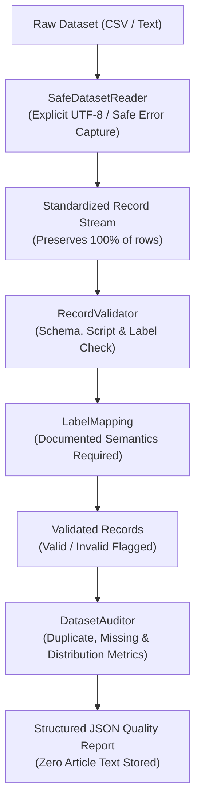

# VeriNews — ML Data Foundations & Validation Engine

**Phase:** P08 Python ML Data Foundations  
**Status:** Implemented & Verified with Synthetic Fixtures (Standard Library First)  
**Package:** `ml/`  
**Dataset Approval Dependency:** Mandatory Mentor Gate (P01 Remains Open; Zero `data/raw/` Access)  

---

## 1. Architectural Role & Overview

The `ml/` package provides a standalone, decoupled data processing, schema validation, and quality auditing foundation for the VeriNews machine learning pipelines.

Adhering strictly to the **Ponytail workflow**:
- Implemented using 100% Python standard library (`csv`, `dataclasses`, `enum`, `hashlib`, `pathlib`, `typing`, `unicodedata`, `statistics`).
- Zero heavy dependencies (no pandas, no NumPy) required for ingestion, validation, or auditing.
- Fully decoupled from web server, database, and client layers.



---

## 2. Implemented Modules

| Module | Location | Primary Responsibilities |
|---|---|---|
| **Schemas** | [`ml/schemas.py`](file:///C:/Users/mddan/Desktop/VeriNews/ml/schemas.py) | `CanonicalLabel` (`CREDIBLE`, `UNRELIABLE`), `Record`, `ValidationError`, `DatasetSchema`, and `QualityReport` dataclasses. |
| **Labels** | [`ml/labels.py`](file:///C:/Users/mddan/Desktop/VeriNews/ml/labels.py) | Explicit `LabelMapping` enforcement. Mandates authoritative citation before ingestion; rejects ambiguous, non-binary, or unmapped labels. Never assumes default `0` or `1` semantics. |
| **Validation** | [`ml/validation.py`](file:///C:/Users/mddan/Desktop/VeriNews/ml/validation.py) | `RecordValidator` enforcing text length bounds, required columns, supported language codes (`en`, `hi`), Devanagari script consistency, and non-empty values. |
| **Readers** | [`ml/readers.py`](file:///C:/Users/mddan/Desktop/VeriNews/ml/readers.py) | `SafeDatasetReader` with explicit encoding handling (`utf-8`, `utf-8-sig`), CSV header validation, and zero silent row discards. |
| **Quality** | [`ml/quality.py`](file:///C:/Users/mddan/Desktop/VeriNews/ml/quality.py) | `DatasetAuditor` computing missing counts, exact duplicate detection (SHA-256 text hashing), label/language distribution, text length stats, and structured JSON audit serialization. |

---

## 3. Supported Input Schema & Validation Rules

### 3.1 Input Schema (`DatasetSchema`)
Datasets are configured using `DatasetSchema` instances:
- `text_column` (default: `"text"`): Primary article text.
- `label_column` (default: `"label"`): Raw classification annotation.
- `id_column` (default: `"id"`): Unique record identifier.
- `language_column` (default: `"language"`): Optional language metadata.
- `title_column` (default: `"title"`): Optional article headline.
- `min_text_length`: Configurable per dataset (`Optional[int]`, default: `20`; `None` disables lower bound).
- `max_text_length`: Configurable per dataset (`Optional[int]`, default: `None` to support full long-form articles of 15,000+ chars).
- `supported_languages`: `{"en", "hi", "hi-latn"}`.
- `strict_script_matching`: `bool` (default: `False`).

### 3.2 Validation Rules
1. **Required Fields**: `text` and `label` are strictly mandatory; missing, null, or whitespace-only values produce `missing_text` or `missing_label` errors.
2. **Text Length Decoupling**: Dataset text lengths are decoupled from the API's live user submission boundaries (100–5,000 chars). Datasets support full long-form investigative articles without truncation or rejection.
3. **Language Metadata vs. Script Inspection**:
   - Language metadata validation checks the declared code against `supported_languages`.
   - Unicode script inspection inspects Devanagari and Latin character distributions.
   - **Romanized Hindi (Hinglish)**: Hindi records written in Latin script are **NOT** automatically rejected. They generate a non-blocking `script_mismatch` warning (`is_warning=True`) while preserving record validity (`is_valid=True`). Rejection occurs only if `strict_script_matching=True` is explicitly configured.
   - **No Auto-Inference**: Pure Latin script text without language metadata is **never** automatically inferred as Hindi.
   - **Mixed Script**: Sentences combining Devanagari and Latin acronyms/technical terms are fully valid without warnings.
4. **No Silent Drops**: Malformed CSV lines or invalid rows are captured as `Record` instances with attached `validation_errors`, ensuring 100% accounting in audit reports.

---

## 4. Label Mapping Requirements

### Strict Anti-Assumption Policy
Different academic corpora use contradictory label polarities:
- Some datasets assign `1 = Real, 0 = Fake`.
- Other datasets assign `1 = Fake, 0 = Real`.
- Still others use text strings (`"credible"`, `"fake"`, `"sensational"`).

To prevent accidental model inversion:
- **Never Assume Defaults**: The engine never defaults `0` to Fake or `1` to Real.
- **Mandatory Documentation Reference**: Every `LabelMapping` must provide an authoritative paper DOI, Zenodo link, or datasheet citation (`documentation_reference`) and a semantic `source_description`.
- **Binary Mandate**: Both `CanonicalLabel.CREDIBLE` and `CanonicalLabel.UNRELIABLE` must be mapped; non-binary or partial mappings are rejected with `LabelMappingError`.
- **Ambiguity Rejection**: Unknown or unmapped raw values raise explicit errors.

---

## 5. Duplicate Detection Boundary

- **Exact Duplicate Detection (Implemented & Tested)**: Computed via SHA-256 hashes of stripped article text. Stored in audit reports as `exact_duplicate_count` with `duplicate_detection_method: "exact_sha256_text_hash"`.
- **Semantic Duplicate Detection (Explicitly NOT Claimed)**: Dense embedding or nearest-neighbor duplicate detection is not implemented in this phase and is explicitly flagged in audit reports as `semantic_duplicate_detection: "not_implemented_or_claimed"`.

---

## 6. Privacy & Security Boundaries

1. **Zero Raw Text in Audit Reports**: Generated JSON quality reports contain aggregate statistics, distribution metrics, and sanitized error summaries. Full article bodies are never persisted in audit JSON files.
2. **Zero PostgreSQL Text Persistence**: No submitted or processed article text is stored in the database.
3. **Decoupled Test Fixtures**: All testing uses synthetic fixtures located in [`ml/tests/fixtures/`](file:///C:/Users/mddan/Desktop/VeriNews/ml/tests/fixtures/). Nothing inside `data/raw/` is accessed.

---

## 7. Dataset Approval Dependency & Synthetic Testing

P01 remains an open research gate awaiting mentor approval.

- **`data/raw/` Access**: 100% prohibited and bypassed.
- **Testing Approach**: 28 automated tests execute against synthetic, handcrafted sample fixtures containing non-copyrighted, illustrative news notices.
- **Execution**:
  ```bash
  .venv\Scripts\python.exe -m pytest ml/tests -v
  ```

