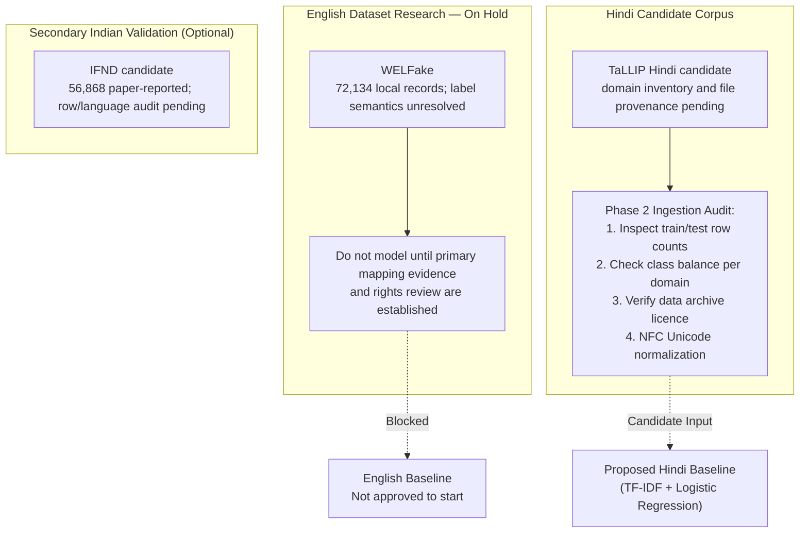

# Dataset Comparison & Selection Matrix: VeriNews

## 1. Master Dataset Comparison Matrix

The table below synthesizes all researched candidate datasets across English and Hindi for the VeriNews platform:

| Dataset Name | Primary Language | Academic Citation / Authors | Verifiable Record Status | Label Classes | Class Balance Status | Primary Text Format | License Status | Direct Public Access | Candidate Status for VeriNews |
| :--- | :--- | :--- | :---: | :--- | :---: | :--- | :--- | :---: | :--- |
| **WELFake** | English | Verma et al. (*IEEE TCSS* 2021) | Local strict parse: 72,134 records; Zenodo also says 78,098 entries, cause unresolved | Zenodo says `0`=Fake, `1`=Real; local raw counts conflict with reported class totals; semantic mapping unresolved | Local: 35,028 zeros / 37,106 ones | Article body + title | Zenodo declares CC BY 4.0; upstream rights unresolved | Yes ([Zenodo DOI](https://doi.org/10.5281/zenodo.4561253)) | **On hold** pending primary label resolution |
| **ISOT Fake News** | English | Ahmed, Traore, Saad (2017/2018) | Official description reports 44,898 (21,417 Real, 23,481 Fake) | True/Real and Fake groups; labels are source-based, not individually verified per article | 47.7% Real / 52.3% Fake (official reported) | Full article body + title (two CSVs) | Official page offers download; explicit dataset licence not established | Yes ([UVic ISOT Lab](https://onlineacademiccommunity.uvic.ca/isot/2022/11/27/fake-news-detection-datasets)) | **Conditional only**: serious source/label confounding and rights review required |
| **LIAR** | English | Wang (*ACL* 2017) | 12,836 paper-reported | Six human PolitiFact truthfulness ratings | Multi-class | Short political statements (TSV) | Author distribution says research-purpose use; no open data licence verified | Yes ([UCSB author page](https://www.cs.ucsb.edu/~william/software.html)) | **Adjacent claim-verification benchmark**, not article replacement |
| **FakeNewsNet** | English | Shu et al. (*Big Data* 2020) | ~23,000 | Binary (PolitiFact / GossipCop) | Variable | Tweet IDs & URL references (JSON) | Academic | Partial ([GitHub](https://github.com/KaiDMML/FakeNewsNet)) | **EXCLUDED** (Dynamic crawling violates reproducibility) |
| **TaLLIP Multilingual** | English, Hindi, Swahili, Vietnamese, Indonesian (repository-reported) | De et al. (ACM TALLIP, DOI 10.1145/3472619) | Train/test text files listed; exact counts not measured | Label encoding requires file inspection | README lists six; paper abstract says seven; second repo has seven domain-named files including Sports | `.txt` files listed in second repo tree; content not inspected | Arko98 code MIT; second repo has no visible licence; data licence unverified | Two public repositories; upstream archive link is not archive verification | **Potential English/Hindi candidate**, subject to content, label, provenance and rights checks |
| **HinFakeNews** | Hindi (Devanagari) | Sharma & Arya (*ACM TALLIP* 2023) | ~33,300 (Paper-reported) | Binary + 5 Topical Categories | Balanced IFCN samples (Reported) | Scraped text + metadata | Restricted / Unreleased | **No** (Direct author inquiry required) | **BLOCKED** (No public repository link) |
| **IFND** | Paper/repository do not clearly specify language per row; verify | Sharma & Garg, *Complex & Intelligent Systems* | Paper: 56,868; author repo has `IFND.csv`; row count not inspected; 56,713 remains unexplained | `1=True`, `0=Fake` (repository-reported) | Paper describes augmented fake items | Statement/title, image URL, category, date, label | README says research-purpose use; no formal dataset licence identified | Author repo accessible | **Unresolved candidate**; not approved as external test |
| **BharatFakeNewsKosh** | Hindi, English, Regional | *BharatAuthenticNet* (2023–2024) | ~26,000 (Paper-reported) | Binary | Variable | Social media posts (CSV) | Academic | Yes (Kaggle) | **EXCLUDED** (High noise, code-mixed Hinglish) |

---

## 2. Evidence Status

To maintain scientific integrity and prevent unverified assumptions, the evidentiary backing for every candidate dataset is categorized below:

### 2.1 Repository/paper claims checked against cited primary pages (not archive-verified)
- **WELFake repository record**: Zenodo record and API describe 72,134 articles (35,028 real; 37,106 fake), say the CSV has 78,098 data entries and only 72,134 are “accessed as per the data frame,” give four fields and mapping `0 = fake`, `1 = real`, and declare CC BY 4.0 in API metadata (`license.id=cc-by-4.0`). The local file now parses to 72,134 four-field records, but its labels are `0: 35,028`, `1: 37,106`; the semantic conflict remains unresolved. Metadata does not establish upstream rights or explain the 78,098 statement.
- **ISOT Structure & Size**: Verified via University of Victoria ISOT repository: 44,898 total articles divided into `True.csv` (21,417) and `Fake.csv` (23,481).
- **TaLLIP sources**: Both README sources report five languages plus combined train/test data and list six domain names; paper abstract says seven domains. Second repository tree includes seven domain-named text files, including Sports. This suggests a README omission, but equivalence/version remains unresolved. MIT code licence is not a dataset licence.
- **LIAR Format & Citation**: Verified via ACL 2017 paper and UCSB distribution: 12,836 short statements with 6-class labels.

### 2.5 Label-integrity decision and alternative review (2026-11-06)
- See [WELFake label-integrity investigation](welfake-label-integrity-investigation.md): higher-limit strict parsing resolves the apparent malformed rows; label semantics remain unresolved because local counts and Zenodo's explicitly stated mapping conflict. No reversal is authorized.
- See [WELFake alternative-resolution report](welfake-alternative-resolution.md): no verified author-maintained WELFake code or supplement was found to settle mapping. ISOT is an article-format candidate but its official page did not establish a dataset licence and collection sources strongly confound labels. LIAR has human fact-check ratings but is short-claim text and its distribution notice restricts use to research purposes. Neither is approved as a direct replacement.

### 2.2 Paper-Reported (Documented in published papers but pending independent local verification)
- **WELFake Performance Baselines**: The accuracy and F1 scores reported in Verma et al. (2021) reflect specific neural embeddings and cannot be assumed for simpler TF-IDF pipelines until locally benchmarked.
- **TaLLIP domain distribution**: Second repo lists seven domain-named files, but contents, equivalence and class counts have not been inspected.
- **HinFakeNews Scale**: The 33,300 article count and linguistic feature mappings are reported in Sharma & Arya (2023) but cannot be independently validated due to lack of a public download.
- **IFND Statistics**: Paper states 56,868, initial fake collection of 7,271, and a final table of 37,809 true + 19,059 fake. This implies 11,788 augmented fake records relative to 7,271, but the paper also mentions separately scraping 20,000 additional real items without reconciling those statements clearly. The author repository contains `IFND.csv` (11,674,892 bytes per GitHub API), not locally inspected. The 56,713 figure is not explained by checked primary sources. Paper CC BY 4.0 applies to publication, not automatically CSV; README says research-purpose use only and formal data licence/redistribution terms are unresolved.

### 2.3 Requires archive inspection / experimental validation (later P08–P10)
- **Exact Hindi Record Count in TaLLIP**: Exact row counts in the listed Hindi train/test `.txt` files must be measured after user-provided local inspection; do not assume CSV/archive format.
- **WELFake Null and Short Row Count**: The exact number of rows with `NaN` text or text < 100 characters must be measured during preprocessing.
- **Duplicate and Near-Duplicate Counts**: Deduplication analysis across and within splits must be run programmatically.
- **Source Leakage Artifacts**: The exact frequency of wire agency datelines (`WASHINGTON (Reuters) - ...`) in WELFake and fact-checking markers in Hindi data must be quantified.

### 2.4 Licence / Access Confirmation Required
- **WELFake Upstream Permissions**: Zenodo record declares CC BY 4.0. Its description says merged from Kaggle, McIntire, Reuters and BuzzFeed Political. Whether the depositor had authority to relicense every underlying item, and whether downstream redistribution is safe, requires legal/rights review; archive notices alone cannot settle this.
- **TaLLIP Data Licence**: Arko98 repository MIT licence covers repository code as displayed, not necessarily data. A second repository contains train/test text files but no visible licence. Dataset reuse/redistribution rights remain **UNVERIFIED**; seek an explicit dataset licence/permission from the authors or repository maintainers.
- **IFND Usage Terms**: Unverified. Do not assume academic-only permission or that citation grants reuse rights.

## 5. Audit corrections and evidence boundaries (accessed 2026-11-06)

Evidence labels used here: **VERIFIED** (authoritative primary source directly checked), **PAPER-REPORTED**, **REPOSITORY-REPORTED**, **REQUIRES ARCHIVE INSPECTION**, **REQUIRES EXPERIMENTAL VALIDATION**, **UNVERIFIED**.

- WELFake: [record](https://zenodo.org/records/4561253), [record API](https://zenodo.org/api/records/4561253), [files API](https://zenodo.org/api/records/4561253/files). **VERIFIED as current Zenodo metadata** on 2026-11-06: API explicitly has `metadata.license.id=cc-by-4.0`; HTML Rights section also names CC BY 4.0. Zenodo reports 72,134 articles, labels/counts, 78,098 CSV entries vs 72,134 accessed, and file key `WELFake_Dataset.csv` (245,086,152 bytes). Cause of count discrepancy remains **UNVERIFIED**. Upstream rights are not established by the deposit's declaration; local archive not downloaded or inspected.
- TaLLIP: [Arko98 repository](https://github.com/Arko98/TALLIP-FakeNews-Dataset), [second repository](https://github.com/amanifeunou/TaLLIP_Dataset), paper [DOI 10.1145/3472619](https://doi.org/10.1145/3472619). README claims English, Hindi, Swahili, Vietnamese and Indonesian; both READMEs list six domains. The paper abstract reproduced in Arko98 README reports seven. GitHub recursive tree for second repo shows English/Hindi/etc. Train/Test `.txt` data and seven domain-named files: Business, Celebrity, Education, Entertainment, Politics, Sports, Technology. This suggests the README omits Sports, but exact provenance/version and meaning of complete-vs-domain files still need archive/content inspection. Arko98 has a repository MIT licence; second repository has no visible licence. Neither establishes a dataset licence.
- IFND: [paper](https://pmc.ncbi.nlm.nih.gov/articles/PMC8520332/), [author repository](https://github.com/sonalgarg174/Dataset), [repository README](https://github.com/sonalgarg174/Dataset/blob/main/README.md), and [GitHub contents API](https://api.github.com/repos/sonalgarg174/Dataset/contents). **PAPER-REPORTED**: 56,868; augmentation algorithm combines fake-news sentences after initial fake-source set of 7,271; final table says 37,809 true and 19,059 fake. Paper describes article titles/statements, images, source, date, categories and True/Fake labels, but does not give a per-row language specification in checked passages. **REPOSITORY-REPORTED**: `IFND.csv` exists; README defines `1=True`, `0=Fake`, describes Indian news, and says research-purpose use only; GitHub API returns no repository licence. 56,713 remains unexplained; CSV row count/content not inspected. Do not use as independent external test until overlap, augmentation, versions, languages and rights are audited.

### Data-quality and evaluation policy (all candidates)

For each source, Phase P08 must record exact source/version, label provenance/mapping, language and class counts, null/empty/short-text counts, exact and near duplicates, topic/date/source distributions and any augmentation. Publisher/collection-source artifacts and topic-label correlations are leakage risks. Deduplicate before splitting; group exact/near duplicates and, where metadata supports it, publisher/source or event groups so related items do not cross partitions. Use stratified train/validation/test as a baseline only; reserve a final test set untouched by preprocessing choices, vectorizer fitting, feature selection, tuning or calibration. Fit the vectorizer on training data only. Report random-split results alongside grouped, temporal, domain-held-out, language-wise and external tests where feasible. Random splitting alone may leak duplicates, topics, sources and collection artifacts and overstate generalization. Never combine WELFake and ISOT without overlap/source audit; separate language-specific training is the working hypothesis, not a proven necessity.

### Phase roadmap (authoritative)

P00 Product Scope and Requirements → P01 Research & Dataset Feasibility → P02 Figma UI/UX Design → P03 Frontend Foundation → P04 Complete Frontend with Mock Data → P05 Database Concepts and Design → P06 Backend Foundation and API Contract → P07 Backend + Database Integration → P08 Python/ML Data Foundations and Dataset Preparation → P09 NLP Preprocessing and Language Routing → P10 Classical ML Training and Evaluation → P11 Calibration, Explainability, Benchmarking and Model Artifacts → P12 Optional Advanced Transformer Experiment → P13 ML + FastAPI + Frontend Integration and Persistence → P14 Testing, Security, Privacy and Performance → P15 Deployment, Documentation and v1.0 Release.

---

## 3. Evaluation Criteria Analysis

### 3.1 Academic Provenance and Peer Review
- **WELFake** and **ISOT** are peer-reviewed in IEEE Transactions (2021) and Springer (2017/2018).
- **TaLLIP** is peer-reviewed in ACM TALLIP (2021) by researchers at IIT Patna and IIT Hyderabad.
- **HinFakeNews** is peer-reviewed in ACM TALLIP (2023), but lacks public data access.

### 3.2 Text Length and Structure Alignment
VeriNews functional requirements stipulate news articles or paragraphs between **100 and 5,000 characters**.
- **Format-compatible only (not approved datasets)**: WELFake, ISOT, and TaLLIP are described as containing article-length text. WELFake label semantics remain unresolved; ISOT has serious source/label confounding and no explicit licence established; TaLLIP provenance and licence remain unresolved.
- **Rejected**: LIAR consists of one-sentence political soundbites (average 17.9 words), and BFNK consists of social media chatter. These lack paragraph structure necessary to evaluate news reporting style.

---

## 4. Proposed Dataset Candidate Selection for Phase 2

1. **English candidate status**: **No approved dataset yet.** WELFake remains on hold because the label mapping is unresolved; ISOT requires licence review and source-aware study design. LIAR is an adjacent claim-level benchmark, not an article substitute. See [the alternative-resolution report](welfake-alternative-resolution.md).
2. **Hindi Candidate**: **TaLLIP Multilingual Dataset (`Arko98/TALLIP-FakeNews-Dataset`)**
   - Publication: De et al., ACM TALLIP 2021 (IIT Patna / IIT Hyderabad).
    - Status: Potential candidate only; inspect available files, exact row count, labels, provenance, and data licence before selection.
3. **Possible secondary corpus**: **IFND**, not approved for external validation until the competing counts (56,868 paper-reported; 56,713 prior notes), repository/archive, labels, language, overlap and licence are resolved.
