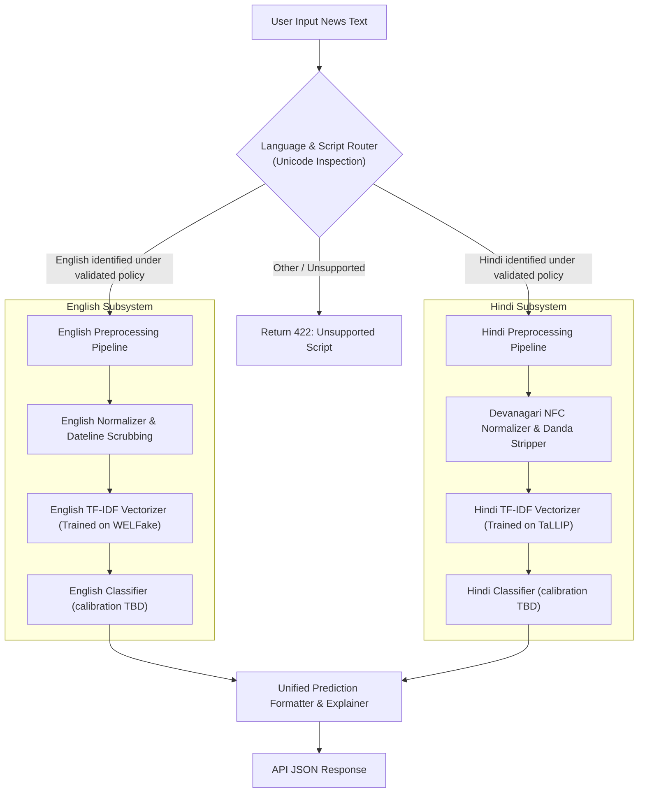

# Dataset Compatibility & Fusion Analysis: VeriNews

## 1. Executive Summary

This document evaluates whether English and Hindi datasets can and should be merged into a single unified training corpus, or whether they should be decoupled into language-specific pipelines. 

Separate language-specific pipelines are a reasonable initial hypothesis to compare against a shared representation; neither is empirically established as superior.

---

## 2. In-Depth Compatibility Dimensions

### 2.1 Label Semantic Equivalence
- **English Corpora (WELFake, ISOT)**:
  - Binary labels (`1 = Real`, `0 = Fake`).
  - "Fake" predominantly encompasses fabricated political propaganda, clickbait satire, hyper-partisan opinion pieces presented as factual reporting, and conspiratorial fabrications from 2016–2020 Western political cycles.
- **Hindi/Indian candidates (TaLLIP, IFND)**:
  - TaLLIP reports Real/Fake classes; IFND author README reports `1=True`, `0=Fake`. Language and label composition must be checked in source files before treating them as Hindi datasets.
  - Do not assume the same label semantics across corpora. IFND includes synthetically augmented fake text according to its paper, so its examples may differ materially from independent news and cannot be treated as independent external evidence without provenance/overlap review.
- **Verdict**:
  - While both reflect the high-level dichotomy between credible journalism and unreliable disinformation, the underlying social and linguistic tropes differ. Treating them as identical requires acknowledging that stylistic signals of sensationalism are culturally and regionally contextual.

---

### 2.2 Source Overlap and Deduplication Risks
- **WELFake vs. ISOT**:
  - WELFake specifically aggregated data from Kaggle, McIntire, BuzzFeed, and Reuters. ISOT was built from Reuters and PolitiFact.
  - Merging WELFake and ISOT produces tens of thousands of duplicate articles. **They must never be merged together.**
- **English vs. Hindi**:
  - Zero source overlap. English sources originate from US/Western media crawls, while Hindi sources originate from Indian regional media (*Dainik Jagran*, *Amar Ujala*, *NDTV Hindi*, *Alt News Hindi*, *BOOM Live Hindi*).

---

### 2.3 Lexical Overlap and the Dual-Pipeline Engineering Hypothesis

In evaluating whether English and Hindi corpora should be trained via a single combined TF-IDF matrix or through decoupled language pipelines, we analyze the actual token distribution and formalize an engineering hypothesis.

#### 1. Token Overlap Is Non-Zero in Real-World News Text
It is inaccurate to assert that English and Hindi have exactly 0% token overlap. Real-world Hindi digital journalism frequently incorporates shared and cross-script tokens:
- **Numerals and Dates**: Arabic digits (`0–9`), currency symbols, percentages (`%`), and standard date formats appear identically across both English and Hindi articles.
- **Punctuation**: Question marks (`?`), exclamation points (`!`), quotation marks (`"`, `'`), and parentheses are shared, alongside Hindi-specific punctuation like the danda (`।`).
- **Global Acronyms and Named Entities**: High-frequency entities such as `COVID-19`, `WHO`, `NASA`, `AI`, `CBI`, `Twitter`, and `GDP` routinely appear in Latin characters within Devanagari Hindi text.
- **Borrowed Words and Transliterations**: Technical, medical, and socio-political vocabulary is frequently borrowed or transliterated.

#### 2. The Engineering Hypothesis: Decoupled Pipelines vs. Joint Representation
While token overlap is demonstrably non-zero, the **vast majority of lexical content remains script-distinct** (Devanagari script `\u0900-\u097F` vs. Basic Latin `\u0000-\u007F`). 

Consequently, we formulate the **Decoupled Dual-Pipeline Architecture as an engineering hypothesis** to be tested and validated against a joint model, rather than asserting it as an immutable mathematical necessity:

- **Preprocessing Divergence**:
  - English requires ASCII case folding, English stopword removal (*the*, *is*, *at*), and wire dateline stripping (`WASHINGTON (Reuters) - ...`).
  - Hindi requires Devanagari Unicode NFC normalization, matra consistency checks, danda stripping (`।`, `॥`), and curated Hindi stopword removal (*है*, *और*, *के*).
  - Applying a unified preprocessor risks either corrupting Devanagari diacritics or failing to normalize language-specific orthography.
- **Sample Scale Asymmetry and Regularization**:
  - The candidate English corpus (WELFake) contains over 70,000 articles, whereas candidate Hindi corpora typically contain several thousand records.
  - In a joint linear model (Logistic Regression / SVM), the shared regularization parameter ($\lambda$) and global loss gradient would be heavily dominated by the high-resource English samples, potentially suppressing feature weights for Hindi terms.
- **Interpretability and Explainability Cleanliness**:
  - Surfacing top-10 influential words for an everyday Hindi reader is dramatically more coherent when derived from a vectorizer tuned specifically to Hindi vocabulary distributions without interference from English frequency baselines.

#### 3. Empirical Verification Plan for Phase 2:
During Phase 2 data ingestion, we will directly measure:
1. Exact vocabulary overlap percentage between the processed English and Hindi training vocabularies ($|V_{\text{en}} \cap V_{\text{hi}}| / |V_{\text{en}} \cup V_{\text{hi}}|$).
2. Cross-lingual classification performance under a decoupled model vs. an experimental unified TF-IDF baseline to empirically validate or refine this hypothesis.

---

### 2.4 Source Leakage & Domain Shortcuts
- **English Leakage Artifacts**:
  - Real articles from Reuters frequently start with: `WASHINGTON (Reuters) - ...` or `LONDON (Reuters) - ...`.
  - Classifiers learn to associate `"Reuters"` with `100% Real`, ignoring actual linguistic structure.
- **Hindi Leakage Artifacts**:
  - Fact-checked fake news articles often preserve fact-checker boilerplate:
    - `"वायरल पोस्ट की पड़ताल में पाया गया कि..."` (*"Investigation into the viral post revealed that..."*)
    - `"विश्वास न्यूज की पड़ताल..."` (*"Vishwas News fact check..."*)
  - If uncleaned, the classifier classifies any article containing `"पड़ताल"` (*investigation/fact check*) as `Fake`!

**Required Guardrail**: Both corpora must undergo rigorous regex cleaning to remove publisher datelines, wire agency names, and fact-checking editorial markers before tokenization.

---

## 3. Language Identification Reliability

To route incoming user submissions accurately between decoupled pipelines, VeriNews requires deterministic language detection.

### MVP language strategy (not a validated detector)
Script detection is not language identification. Devanagari presence does not prove Hindi; Latin script does not prove English and may be Romanized Hindi/Hinglish. The former 20% Devanagari threshold is unvalidated and withdrawn as a reliability claim. Use script proportions only to identify clear script patterns. Route English or Hindi only under a validated language-identification policy. Reject or ask the user to select/re-submit for ambiguous, mixed-language, low-confidence or unsupported input. Never silently route Hinglish as English. Evaluate a lightweight identifier using labeled English, Devanagari Hindi, Hinglish, mixed-script and unsupported examples before setting thresholds; tool choice is deferred pending evidence and dependency review.

---

## 4. Architectural Decision: Decoupled Dual Pipeline

### Summary of Decisions & Verification Next Steps:
1. **Primary Working Hypothesis**: Maintain WELFake (English) and TaLLIP (Hindi) in separate preprocessing and training pipelines for the Scikit-learn baseline.
2. **Empirical Verification in Phase 2**: Compute exact token intersection metrics, measure code-mixing prevalence, and benchmark dual pipelines against a unified baseline.
3. **Dual Model Serialization Target**: Pending verification, serialize separate language artifacts:
   - `model_en.joblib` + `vectorizer_en.joblib`
   - `model_hi.joblib` + `vectorizer_hi.joblib`
4. **Multilingual Transformer Role**: Reserve joint multilingual fine-tuning for optional secondary research experiments (XLM-RoBERTa), only if baseline limits justify it.

### Explicit support policy
- Supported targets: English and Hindi in Devanagari, subject to dataset/model validation.
- Romanized Hindi/Hinglish is deferred; flag as unsupported/ambiguous, never silently treat it as English.
- Mixed-language text requires explicit, experimentally validated handling; MVP may ask for a single-language excerpt.
- Other languages/scripts receive a clear unsupported-language response, not a prediction.
