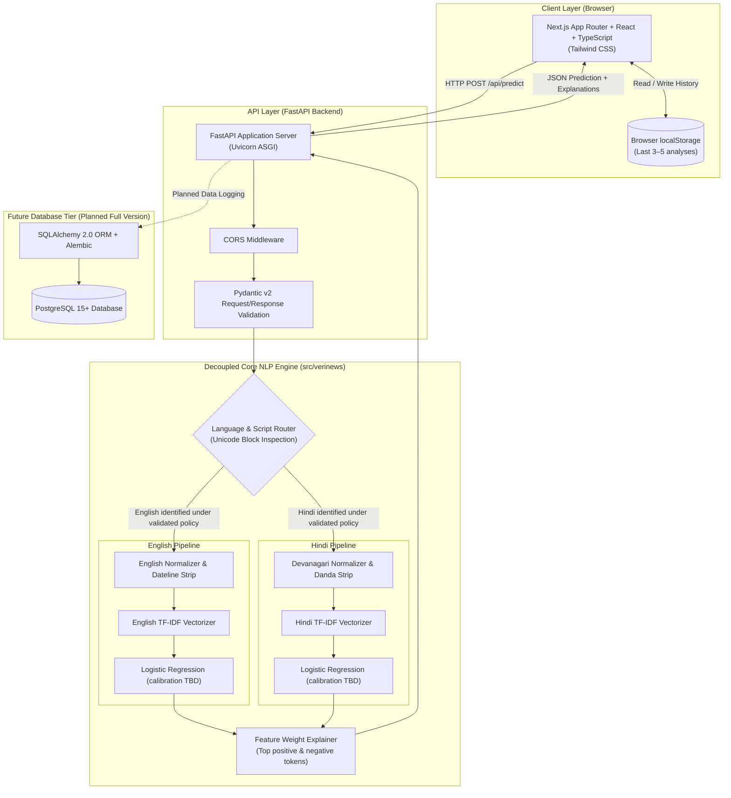
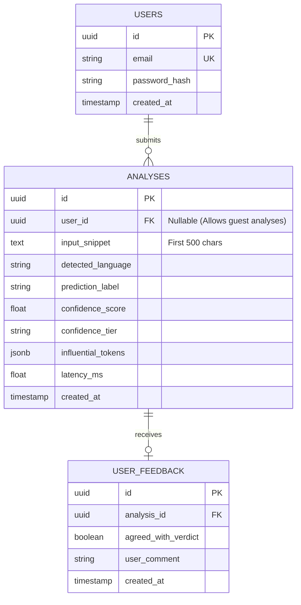

# Full-Stack Technical Architecture: VeriNews

## 1. Executive Architectural Blueprint

VeriNews is architected as a clean, decoupled, high-performance web platform that bridges modern web technologies with CPU-optimized NLP machine learning pipelines.



---

## 2. Technology Stack Definition

| Subsystem | Approved Technology | Justification & Architectural Role |
| :--- | :--- | :--- |
| **Frontend** | **Next.js App Router + React + TypeScript + Tailwind CSS** | Type-safe React application with file-based routing, server-rendered page structure, and responsive utility-first CSS. Remains a separate frontend from the Python API. |
| **Backend** | **Python + FastAPI + Pydantic** | REST API, OpenAPI schema generation and request validation. Async syntax does not make CPU-bound inference non-blocking. |
| **ML Engine (Baseline)** | **Python + Scikit-Learn (TF-IDF + Logistic Regression)** | Proposed CPU-first baseline; probability calibration and performance are unmeasured. Compare with Multinomial Naive Bayes and Linear SVM. |
| **ML Engine (Advanced)** | **Hugging Face / PyTorch (XLM-RoBERTa / IndicBERT)** | Researched and benchmarked in secondary cloud experiments to evaluate contextual cross-lingual transfer without blocking CPU production. |
| **MVP History** | **Browser `localStorage` (last 3–5 items)** | Client-only convenience storage, not fully private or secure. Same-origin JavaScript can read it; XSS and shared-device exposure are risks. Provide delete/clear controls and avoid storing sensitive text. |
| **Production Database** | **PostgreSQL + SQLAlchemy 2.0 + Alembic** | Enterprise relational storage planned for the full application to manage persistent user accounts, historical queries, and user feedback. |
| **Hardware Boundary** | **100% CPU-Compatible** | All production dependencies and serialized joblib artifacts execute locally on standard consumer x86_64 CPUs without CUDA or GPU dependencies. |

---

## 3. Communication Protocol & API Contracts

All client-backend interactions occur over stateless HTTP REST endpoints communicating via standard JSON payloads.

### 3.1 API Endpoints Specification

#### 1. `GET /api/health`
- **Purpose**: Server health check and loaded model status verification.
- **Response `200 OK`**:
  ```json
  {
    "status": "healthy",
    "version": "1.0.0",
    "models_loaded": {
      "english": true,
      "hindi": true
    }
  }
  ```

#### 2. `GET /api/samples`
- **Purpose**: Provides pre-curated test news snippets for one-click testing in the frontend UI.
- **Response `200 OK`**:
  ```json
  [
    {
      "id": "sample-en-credible",
      "language": "en",
      "category": "Credible Journalism",
      "title": "NASA Rover Collects Rock Samples on Mars",
      "text": "NASA's Perseverance rover has successfully collected two rock samples from an ancient river delta in Jezero Crater, scientists reported Tuesday. The samples will be stored in sealed tubes for a future return mission..."
    },
    {
      "id": "sample-hi-sensational",
      "language": "hi",
      "category": "Sensationalist / Unreliable",
      "title": "चमत्कारी पत्ते से कैंसर तुरंत ठीक होने का दावा",
      "text": "सोशल मीडिया पर वायरल हो रहे इस मैसेज में दावा किया जा रहा है कि इस चमत्कारी पत्ते का रस पीने से कैंसर कुछ ही दिनों में पूरी तरह ठीक हो जाता है। वैज्ञानिकों ने इस दावे को पूरी तरह खारिज किया है..."
    }
  ]
  ```

#### 3. `POST /api/predict`
- **Purpose**: Core inference endpoint. Accepts raw news text, detects language, executes preprocessing, scores credibility, and extracts influential words.
- **Request Body (`application/json`)**:
  ```json
  {
    "text": "Shocking miracle cure revealed by anonymous researchers..."
  }
  ```
- **Response `200 OK`**:
  ```json
  {
    "detected_language": "en",
    "language_name": "English",
        "label": "MOCK / ILLUSTRATIVE ONLY — Potentially Unreliable / Sensationalist",
    "is_credible": false,
    "confidence_score": null,
    "confidence_tier": "Not yet evaluated",
    "confidence_percentage": null,
    "influential_tokens": [
      { "token": "example-token", "weight": null, "direction": "illustrative" }
    ],
    "disclaimer": "VeriNews analyzes stylistic and linguistic markers. This assessment does not verify empirical facts. Always verify important news with accredited fact-checkers.",
    "execution_time_ms": null
  }
  ```
- **Error Responses**:
  - `400 Bad Request`: Text is shorter than 100 characters or exceeds 5,000 characters.
  - `422 Unprocessable Content`: Unsupported script/language detected.
  - `500 Internal Server Error`: Unhandled inference exception (logged safely without leaking stack traces).

---

## 4. End-to-End Prediction Flow

The interaction sequence below illustrates the end-to-end lifecycle of an analysis request:

```mermaid
sequenceDiagram
    autonumber
    actor User as News Consumer
    participant UI as Next.js App Router frontend
    participant LS as Browser localStorage
    participant API as FastAPI Server
    participant Router as Language Router
    participant Core as ML Inference Pipeline

    User->>UI: Pastes news text & clicks "Analyze"
    UI->>UI: Client validation (Length: 100–5,000 chars)
    alt Validation Fails
        UI-->>User: Display inline validation warning
    else Validation Passes
        UI->>UI: Set loading state & spinner
        UI->>API: POST /api/predict { text: "..." }
        API->>Router: Inspect script character distribution
        
        alt Hindi identified under validated policy
            Router->>Core: Route to Hindi Pipeline
        else Basic Latin Script
            Router->>Core: Route to English Pipeline
        else Unsupported Script
            Router-->>API: Reject (422 Unsupported Script)
            API-->>UI: 422 JSON Error message
            UI-->>User: Display friendly script error
        end
        
        Core->>Core: Apply language-specific cleaning
        Core->>Core: Vectorize text via trained TF-IDF
        Core->>Core: Evaluate Logistic Regression weights & sigmoid
        Core->>Core: Expose calibrated score only if later validated; otherwise no confidence tier
        Core->>Core: Slice top positive/negative coefficients
        Core-->>API: Return PredictionResult object
        API-->>UI: 200 OK JSON response
        UI->>LS: Append analysis to history (Keep last 3–5)
        UI-->>User: Render verdict, confidence badge, tokens & disclaimer
    end
```

---

## 5. Model Inference & Runtime Memory Strategy

> [!NOTE]
> All latency figures and memory numbers below represent **provisional engineering targets**, not measured benchmarks. Actual performance will be measured and documented during Phase 2 training.

1. **Load-once model lifecycle**:
   - Both the English (`model_en.joblib`, `vectorizer_en.joblib`) and Hindi (`model_hi.joblib`, `vectorizer_hi.joblib`) artifacts are targeted to load into memory once during application startup via FastAPI's `@asynccontextmanager` lifespan handler.
   - Zero artifact loading occurs during incoming HTTP requests.
2. **CPU concurrency**:
   - Async endpoints do not make CPU-bound inference non-blocking. FastAPI runs ordinary `def` path operations in a threadpool; CPU work in `async def` can block the event loop if called directly. Use an appropriate sync endpoint/threadpool or process strategy after profiling; do not add infrastructure pre-emptively.
   - Load fitted artifacts once at application startup, never train or load them on each request. Measure CPU, RAM, latency and concurrency before choosing worker/process count; each process may duplicate model memory.
3. **Inference Execution Target (provisional)**:
   - Linear model vector dot products $\mathbf{w}^T \mathbf{x} + b$ are targeted to execute in under 10 milliseconds on CPU.
   - Total round-trip latency (client -> API -> inference -> client) is targeted to remain well under the provisional engineering ceiling of **< 1.5 seconds**.
4. **Memory Footprint Target (provisional)**:
   - Total resident set size (RSS) of Uvicorn + FastAPI + Scikit-learn models is targeted to remain under **150 MB**, comfortably satisfying NFR-RES-02 (< 1.0 GB).
5. **Factual Boundary Principle**:
    - A raw model score is not calibrated confidence and not a probability that news is true. Do not label it confidence until calibration and user-facing semantics are validated. Non-dismissible disclaimers reinforce that output is not factual verification.

---

## 6. Future Database Integration Architecture (Planned Full Application)

When transitioning to the persistent full application, PostgreSQL with SQLAlchemy 2.0 ORM will be introduced to persist user analyses, accounts, and feedback flags.

### 6.1 Database Entity-Relationship Diagram



### 6.2 Migration Strategy:
- **Alembic**: Database schema revisions managed as versioned migration scripts in `alembic/versions/`.
- **Stateless Isolation**: The core ML engine remains 100% decoupled from the database; the DB session is handled purely in FastAPI dependency injection (`Depends(get_db)`).

---

## 7. Model Versioning & Artifact Serialization

To guarantee reproducibility and avoid runtime serialization mismatch:

```
models/
├── en/
│   └── v1.0.0/
│       ├── model.joblib          # Trained LogisticRegression classifier
│       ├── vectorizer.joblib     # Fitted TfidfVectorizer
│       └── metadata.json         # Training metrics, dataset hash, hyperparameters
└── hi/
    └── v1.0.0/
        ├── model.joblib
        ├── vectorizer.joblib
        └── metadata.json
```

### Metadata JSON Schema:
```json
{
  "language": "en",
  "version": "1.0.0",
  "model_type": "LogisticRegression",
  "vectorizer": "TfidfVectorizer",
  "ngram_range": [1, 2],
  "max_features": 25000,
  "dataset": "WELFake",
    "dataset_sha256": null,
    "training_timestamp": null,
  "metrics": {
    "train_accuracy": null,
    "test_accuracy": null,
    "test_f1_macro": null
  }
}
```

---

## 8. Error Handling & Edge-Case Resilience

1. **Input Length Violations**:
   - Validated both client-side in React (disabling "Analyze" button with character counter) and server-side in Pydantic.
   - Text < 100 chars: Returns HTTP 400 with explanation.
   - Text > 5,000 chars: Returns HTTP 400 to prevent CPU payload exhaustion.
2. **Unsupported / ambiguous languages**:
   - Low-confidence, mixed-language, Romanized Hindi/Hinglish, or unsupported language should return a clear validation response (proposed 422), not be silently routed. Script detection alone is not language identification; the former 20% rule is unvalidated and withdrawn.
3. **Out-of-Vocabulary (OOV) Edge Case**:
   - If an input text contains words that all have 0 occurrences in the TF-IDF vocabulary, the resulting vector $\mathbf{x} = \mathbf{0}$.
   - The model defaults to the prior intercept bias $b$, yielding a probability near 0.50.
    - Any inconclusive threshold is **TBD** and must be selected using validation data; no numeric range is approved before experiments. A zero vector may result from vocabulary mismatch and should be treated cautiously.
     `"Inconclusive / Low Confidence (Insufficient stylistic markers detected)"`.
4. **Security & Sanitization**:
   - User text is never executed or injected raw into DOM; React automatically escapes strings to prevent Cross-Site Scripting (XSS).
    - Avoid logging submitted text by default; truncating still stores potentially sensitive content. Browser history is local to that browser/device and needs explicit delete/clear behavior; same-origin JS can access it and XSS may expose it. It is not server-side persistent history.

## Roadmap alignment

P00 Product Scope and Requirements → P01 Research & Dataset Feasibility → P02 Figma UI/UX Design → P03 Frontend Foundation → P04 Complete Frontend with Mock Data → P05 Database Concepts and Design → P06 Backend Foundation and API Contract → P07 Backend + Database Integration → P08 Python/ML Data Foundations and Dataset Preparation → P09 NLP Preprocessing and Language Routing → P10 Classical ML Training and Evaluation → P11 Calibration, Explainability, Benchmarking and Model Artifacts → P12 Optional Advanced Transformer Experiment → P13 ML + FastAPI + Frontend Integration and Persistence → P14 Testing, Security, Privacy and Performance → P15 Deployment, Documentation and v1.0 Release.

API contract is a proposal, not implementation: `GET /api/health`, `GET /api/samples`, `POST /api/predict`; request `{text}`; success response should use consistent `detected_language` (`en`/`hi`), output label mapping/model version, and nullable score until calibrated. Errors use a consistent structured schema (for example `code`, `message`, optional field details); proposed 400 for invalid input and 422 for unsupported/ambiguous language. No API is implemented. Browser localStorage history is MVP only; PostgreSQL analysis persistence and user accounts/auth are separate future work. No auth is implied for MVP.

Dataset evidence update (accessed 2026-11-06): WELFake Zenodo record API explicitly declares CC BY 4.0; rights to all upstream aggregated material remain a legal-review question. IFND has an author-repository CSV and research-purpose README, but per-row language, row count/version and dataset redistribution rights remain unresolved; it is not an approved independent external test. TaLLIP repositories list English/Hindi train/test text files; the domain discrepancy and dataset licence remain unresolved. Do not distribute datasets or trained artifacts until rights are reviewed.
